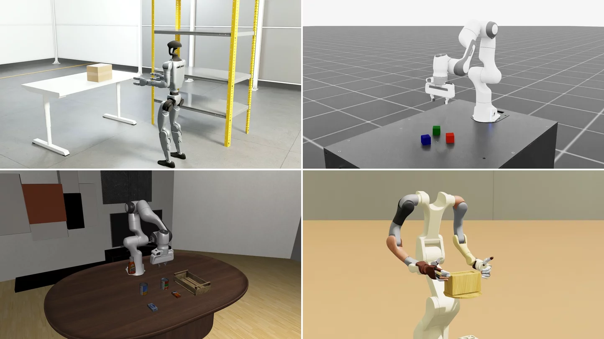

---

# Isaac RL Post-Training

[](https://www.python.org/downloads/)
[](LICENSE)
[](https://github.com/isaac-sim/IsaacLab)
[](https://github.com/isaac-sim/IsaacLab-Arena)

**Isaac RL Post-Training** is a library for raising the success rate of a pretrained robot policy (such as GR00T) on a chosen task with reinforcement learning in simulation.
It covers several families of algorithms, from full fine-tuning methods such as PPO to edit-style approaches such as residual RL and steering-based RL.

It includes workflows for G1 Factory tasks, dexterous tasks from Video-to-Data (V2D), and LIBERO, all in simulation.

> **Note:** G1 Factory tasks will be released soon.
This codebase is a research preview under active development, and its APIs and interfaces may change.

## Key Features

- **Algorithms**: steering of a frozen policy (DSRL, RFS, SAC-edit, DSRL-PPO), online fine-tuning of its action head (PPO), and offline fine-tuning from demonstrations (SFT, IQL).
- **Base models**: GR00T N1.5 and N1.7, pi0 and DreamZero, behind one policy interface.
- **Simulators**: Unitree G1 humanoid tasks in IsaacLab-Arena, Isaac Lab 3.0 manager-based tasks, LIBERO and Video-to-Data, plus an exploratory RoboLab integration.
- **Runtimes**: a native runtime that runs in-process or across Ray actors, and an RLInf runtime, both behind one placement and policy-serving interface.
- **Example workflows**: complete recipes with install steps, train and evaluate commands, and measured results.

## Getting Started

### Quickstart

Linux on x86_64 with [`uv`](https://docs.astral.sh/uv/getting-started/installation/) installed.
No GPU is needed for these steps.

```bash
git clone https://github.com/nvidia-isaac/isaac-rlpt.git
cd isaac-rlpt               # run every command from this repository root
uv sync
```

### Documentation

- [Getting started](docs/pages/getting_started.md): the steps to a first run.
- [Installation](docs/pages/installation.md): every install variant.
- [Concepts](docs/pages/concepts.md): the terms the rest of the docs use.
- [Command-line reference](docs/pages/cli_reference.md) and [troubleshooting](docs/pages/troubleshooting.md).
- Extending the library: [add a simulator](docs/pages/extending/add_a_simulator.md), [add an algorithm](docs/pages/extending/add_an_algorithm.md), [add a base model](docs/pages/extending/add_a_base_model.md).
- [`docs/README.md`](docs/README.md): building the documentation site, which also holds the algorithm pages and the developer reference.

### Example Workflows

Each folder is a complete recipe: what to install, the commands to train and evaluate, and the measured results.

| Workflow | What it does |
|---|---|
| [G1 Factory](example_workflows/g1_arena_posttraining/README.md) | Steer or fine-tune a GR00T N1.7 policy on nine Unitree G1 humanoid tasks |
| [Isaac Lab](example_workflows/isaaclab_gr00t_posttraining/README.md) | Steer or fine-tune a GR00T policy on an Isaac Lab task, from Isaac Lab's own commands |
| [LIBERO](example_workflows/libero_posttraining/README.md) | Steer a GR00T N1.7, pi0 or DreamZero policy on the LIBERO tabletop tasks |
| [DGX Station](example_workflows/dgx_example/README.md) | Split one training run across the two GPUs of a DGX Station |
| [Video-to-Data tissue box](example_workflows/v2d_box_lift_posttraining/README.md) | Steer a GR00T policy that lifts a tissue box in Video-to-Data |

[`example_workflows/README.md`](example_workflows/README.md) describes the folder contract and how to add a workflow.

### Repository Layout

```
isaac_rl_posttraining/   the library: algorithms/, policies/, envs/, runtimes/, training/, buffers/, configs/
scripts/train.py         the one training and evaluation entry point (Hydra)
simulators/              one package per simulator
example_workflows/       runnable recipes with results
docs/                    the documentation site
tests/                   unit and integration tests
tools/                   repository tooling
```

## Contributing

We welcome bug reports, feature requests and code contributions.
To add a simulator, an algorithm or a base model, follow the [extending guides](docs/pages/extending/add_a_simulator.md); to add a workflow, follow [`example_workflows/README.md`](example_workflows/README.md).
Before opening a pull request, run the CPU-safe tests and every workflow's smoke check:

```bash
uv run pytest tests/ simulators/*/tests/ example_workflows/*/tests/ -m "not gpu and not arena and not libero and not slow"
uv run python -m example_workflows._common.smoke
```

See [CONTRIBUTING.md](CONTRIBUTING.md); every commit must be signed off under the Developer Certificate of Origin (`git commit -s`).

## Troubleshooting

See the [troubleshooting](docs/pages/troubleshooting.md) page for common fixes, or [submit an issue](https://github.com/nvidia-isaac/isaac-rlpt/issues).
For issues with a simulator itself, check its own documentation: [Isaac Lab](https://isaac-sim.github.io/IsaacLab), [Isaac Lab-Arena](https://isaac-sim.github.io/IsaacLab-Arena), [LIBERO](https://github.com/Lifelong-Robot-Learning/LIBERO) or [Video-to-Data](https://github.com/nvidia-isaac/video_to_data).

## Support

Use GitHub [Issues](https://github.com/nvidia-isaac/isaac-rlpt/issues) for questions, bug reports, documentation issues and feature requests.

## License

Isaac RL Post-Training is released under the [Apache 2.0 License](LICENSE).
The agent skills under `skills/` and `.agents/contributor-skills/` are licensed under CC-BY-4.0 AND Apache-2.0 ([CC-BY-4.0](LICENSE-CC-BY-4.0) and [Apache 2.0](LICENSE)); code-only files in them are Apache 2.0.
The simulators, base models and datasets it works with carry their own licenses; check each before use.
Third-party code and licenses: see [THIRD_PARTY_NOTICES.md](THIRD_PARTY_NOTICES.md).

This repository retrieves external materials that it does not distribute: the workflows' `fetch_externals.sh` scripts and `uv sync` download third-party source code and Python packages, base models and checkpoints are downloaded from Hugging Face, and the workflow Dockerfiles build images locally from third-party base images.
No container image is distributed with this repository; an image you build contains only what your build retrieves.

**NOTICE AND DISCLAIMER: This software automatically retrieves, accesses or interacts with external materials.  Those retrieved materials are not distributed with this software and are governed solely by separate terms, conditions and licenses.  You are solely responsible for finding, reviewing and complying with all applicable terms, conditions, and licenses, and for verifying the security, integrity and suitability of any retrieved materials for your specific use case. This software is provided "AS IS", without warranty of any kind. The author makes no representations or warranties regarding any retrieved materials, and assumes no liability for any losses, damages, liabilities or legal consequences from your use or inability to use this software or any retrieved materials. Use this software and the retrieved materials at your own risk.**
