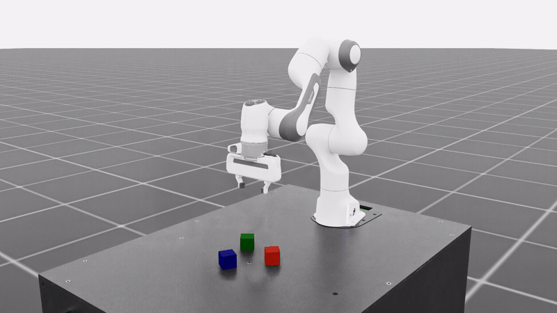

# Isaac Lab Post-Training

Post-train a GR00T N1.5 policy on an Isaac Lab 3.0 task from Isaac Lab's own `train` and `play` commands (`uv run isaaclab train --rl_library isaac_rlpt`).
The steering methods (DSRL, the default, RFS and SAC-edit) keep the policy frozen and train a small learner around it; PPO fine-tunes its action head.
The code is in `example_workflows/isaaclab_gr00t_posttraining/`.



A successful episode of `Isaac-Stack-Cube-Franka-IK-Rel-Visuomotor-v0` in real time, from GR00T N1.5 after 400 iterations of PPO fine-tuning of its action head.

## Overview

| | |
|---|---|
| Task | `Isaac-Stack-Cube-Franka-IK-Rel-Visuomotor-v0`, a Franka stacking three cubes; v0.1 supports this one task |
| Base policy | [`RLinf/RLinf-Gr00t-SFT-Stack-cube`](https://huggingface.co/RLinf/RLinf-Gr00t-SFT-Stack-cube), GR00T N1.5 fine-tuned on cube-stacking demonstrations; 16-step action chunks |
| Methods | `dsrl_sac` (default), `rfs`, `rfs_pc`, `sac_edit` keep the policy frozen; `dsrl_ppo` trains the DSRL steering actor with PPO; `ppo` fine-tunes the action head |
| Reward | sparse: the task's `cubes_stacked` success within the 448-step episode cap |

The steering methods learn from 0 on success and -1 on a failed or capped episode (`env.success_reward`, `env.failure_reward`); `ppo` learns from RLinf's 1 on success and 0 otherwise.
Episode returns in the logs and in `evaluation_summary.json` are the simulator's own success reward, 1 on success, for every method.

## Requirements

| | |
|---|---|
| Hardware | Linux x86-64 (Ubuntu 22.04 or newer, which Isaac Sim's pip packages need) with one 48 GB NVIDIA GPU for a steering run or single-GPU PPO; one 8-GPU node for distributed PPO |
| Isaac Lab | Isaac Sim 6.2 and [Isaac Lab `release/3.0.0`](https://github.com/isaac-sim/IsaacLab/tree/release/3.0.0), installed by `uv sync` with GR00T N1.5 and this repository at the pins in `externals.lock.yaml` and `uv.lock`; the `nvcr.io/nvidia/isaac-lab:3.0.0-beta2` container is the alternative |
| Host tools | Git and [uv](https://docs.astral.sh/uv/getting-started/installation/); Docker with the [NVIDIA Container Toolkit](https://docs.nvidia.com/datacenter/cloud-native/container-toolkit/latest/install-guide.html) only for the container |
| Disk | about 30 GB for the environment (`.venv/`) and uv's download cache, plus 8 GB for the checkpoint |
| Weights & Biases | optional; `--wandb_offline` logs locally without an account |
| Time | 15 to 30 minutes for the first `uv sync`, depending on the network; a 40,000-step steering run takes 2 to 2.5 hours |

The dataset [`RLinf/IsaacLab-Stack-Cube-Data`](https://huggingface.co/datasets/RLinf/IsaacLab-Stack-Cube-Data) is needed only to redo the supervised fine-tuning.

## Installation

Install the workflow in one of two places: directly on your machine with `uv`, or inside the `nvcr.io/nvidia/isaac-lab:3.0.0-beta2` container.
Both end in the workflow folder, and every command after this section is the same in both.

`````{tab-set}

````{tab-item} On your machine

The workflow has its own uv environment, because GR00T N1.5 needs `transformers` 4.51.3 and Isaac Sim 6.2 needs torch 2.11, which the root environment cannot hold.
Isaac Lab is pinned to a commit of its `release/3.0.0` branch until that release is on PyPI.

Run on your machine:

```bash
git clone https://github.com/nvidia-isaac/isaac-rlpt.git
cd isaac-rlpt/example_workflows/isaaclab_gr00t_posttraining
bash ./scripts/fetch_externals.sh  # Isaac Lab, GR00T N1.5 and pytorch3d's rotation code, at their pins, into .externals/
uv sync                            # Isaac Sim 6.2, Isaac Lab (editable), GR00T N1.5 and this repository, into .venv/
export OMNI_KIT_ACCEPT_EULA=yes    # accepts the Isaac Sim license (NVIDIA Omniverse EULA); put it in your shell profile
export CKPT=$PWD/checkpoints/RLinf-Gr00t-SFT-Stack-cube   # any directory with 8 GB free
uv run hf download --repo-type model RLinf/RLinf-Gr00t-SFT-Stack-cube --local-dir "$CKPT"
```

`fetch_externals.sh` ends with `[fetch_externals] done; next: uv sync`; it also registers the `isaac_rlpt` module in the fetched Isaac Lab checkout, so `--rl_library isaac_rlpt` resolves.
Run it again, then `uv sync`, after `externals.lock.yaml` changes.
Without `OMNI_KIT_ACCEPT_EULA`, Isaac Sim stops at its first launch to ask for the license.

````

````{tab-item} In the Isaac Lab container

This path uses the image's own Isaac Sim and Isaac Lab instead of `uv sync`.
Step 1 runs on your machine; steps 2 to 6 run inside the container.
Only `/data` survives when the container exits, so the checkpoint goes there; repeat steps 2 to 6 in every new container.

1. Run on your machine: start the container.

   ```bash
   mkdir -p "$HOME/isaac-rlpt-data"
   docker run --rm -it --gpus all --network host --user root --entrypoint bash \
     -e ACCEPT_EULA=Y -e PRIVACY_CONSENT=Y \
     -v "$HOME/isaac-rlpt-data:/data" \
     nvcr.io/nvidia/isaac-lab:3.0.0-beta2
   ```

2. Inside the container: clone this repository.

   ```bash
   git clone https://github.com/nvidia-isaac/isaac-rlpt.git ~/isaac-rlpt
   ```

3. Inside the container: run the setup script (about five minutes).

   ```bash
   bash ~/isaac-rlpt/example_workflows/isaaclab_gr00t_posttraining/scripts/setup_env.sh
   ```

   It ends with a line starting `[setup_env] done.`
   It installs GR00T N1.5 at its pinned commit into `~/isaac_rlpt` (`WORK` moves it) without touching the image's packages, puts this repository on `PYTHONPATH`, registers the `isaac_rlpt` module with Isaac Lab, and installs `uv`.

4. Inside the container: load the environment it wrote, in every new shell.
   `uv run` then uses the image's own Isaac Sim and Isaac Lab, and the `hf` command becomes available.

   ```bash
   source ~/isaac_rlpt/isaac_rlpt_env.sh
   ```

5. Inside the container: download the checkpoint (about 8 GB).

   ```bash
   export CKPT=/data/checkpoints/RLinf-Gr00t-SFT-Stack-cube
   hf download --repo-type model RLinf/RLinf-Gr00t-SFT-Stack-cube --local-dir "$CKPT"
   ```

6. Inside the container: change to the workflow folder.

   ```bash
   cd ~/isaac-rlpt/example_workflows/isaaclab_gr00t_posttraining
   ```

For multi-GPU PPO (`--runtime rlinf`) only, also run inside the container:

```bash
bash ~/isaac-rlpt/example_workflows/isaaclab_gr00t_posttraining/scripts/setup_runtime.sh
```


With your own Isaac Lab 3.0 installation instead of the container, skip step 1 and run steps 2 to 6 on your machine, with step 3 pointed at your installation:

```bash
ISAACLAB_ROOT=/path/to/IsaacLab PYTHON=/path/to/isaac-sim/python.sh \
  bash ~/isaac-rlpt/example_workflows/isaaclab_gr00t_posttraining/scripts/setup_env.sh
```

````

`````

Every command on this page runs from the workflow folder, `example_workflows/isaaclab_gr00t_posttraining/`.
In every new shell, `cd` there first; in the container, also run `source ~/isaac_rlpt/isaac_rlpt_env.sh`.
`uv run isaaclab` is Isaac Lab's own command line (`isaaclab.sh`).

Both installation routes already register the `isaac_rlpt` module with their Isaac Lab.
To register it with a different Isaac Lab checkout as well:

```bash
python3 ./scripts/install.py --isaaclab /path/to/IsaacLab
```

`--check` reports without changing anything, `--copy` copies instead of symlinking, and `--uninstall` reverts.

## Setup check

From the workflow folder:

```bash
uv run isaaclab train --rl_library isaac_rlpt --list_tasks
```

It prints the tasks with a launch recipe, including `Isaac-Stack-Cube-Franka-IK-Rel-Visuomotor-v0`.
`--dry_run` on any command below prints the launch plan (`launch.*`, `launch.override=` and `plan.*` lines) and launches nothing.
A real launch checks the same plan before Isaac Sim starts, so a configuration error stops it within seconds.

A faster check that does not start Isaac Sim or need a GPU:

```bash
uv run bash smoke.sh
```

It takes under two minutes and ends with `smoke check passed`.

## Training

From the workflow folder:

```bash
TASK=Isaac-Stack-Cube-Franka-IK-Rel-Visuomotor-v0
```

DSRL on eight scenes, 40,000 environment steps, an evaluation every 10,000:

```bash
uv run isaaclab train --rl_library isaac_rlpt --task $TASK --model_path $CKPT --algorithm dsrl_sac \
    --num_steps 40000 --eval_freq 10000 --eval_episodes 32 --num_envs 8 --headless --run_name stack_dsrl
```

The run writes to `logs/isaac_rlpt/stack_dsrl_<timestamp>/`, and every evaluation prints an `[EVAL] Success Rate` line.
`--algorithm rfs`, `rfs_pc` or `sac_edit` selects another steering method; `--num_envs 1` collects from a single scene.
Keep `--eval_episodes` a multiple of `--num_envs`; other counts round up ([cli_reference.md](../cli_reference.md)).
`--algorithm dsrl_ppo --num_envs 8` trains the same steering actor with PPO, budgeted by `--iterations` and `ppo.*` overrides.

PPO on one GPU, then on eight (4 learner ranks, 4 rollout workers):

```bash
uv run isaaclab train --rl_library isaac_rlpt --task $TASK --model_path $CKPT --algorithm ppo --num_envs 16 --run_name stack_ppo

uv run --extra rlinf isaaclab train --rl_library isaac_rlpt --task $TASK --model_path $CKPT --algorithm ppo \
    --runtime rlinf --learner_gpus 4 --rollout_gpus 4 --num_envs 64
```

`--extra rlinf` adds RLInf and Ray to the environment; in the container, step 6 installed them and `uv` ignores the flag with a warning.
`--num_envs` must be a positive multiple of `--rollout_gpus`.

Any argument the parser does not know is passed through as a Hydra override, for example `dsrl.noise_action_bound=2.0`, `algorithm.batch_size=128` or `ppo.cache_features=true`.

### Demonstration co-training

PPO can also train on the checkpoint's original demonstrations, which keeps the policy close to the behaviour in those demonstrations ([PPO](../algorithms/ppo.md#demonstration-co-training)).
Download the stack-cube demonstrations, then pass the two co-training settings through:

```bash
uv run hf download --repo-type dataset RLinf/IsaacLab-Stack-Cube-Data --local-dir $PWD/data/IsaacLab-Stack-Cube-Data
uv run isaaclab train --rl_library isaac_rlpt --task $TASK --model_path $CKPT --algorithm ppo --num_envs 16 \
    --run_name stack_ppo_cotrain ppo.cotrain_beta=0.1 ppo.cotrain_dataset_path=$PWD/data/IsaacLab-Stack-Cube-Data
```

### Served policy

A served policy runs the trainable policy in separate policy-server processes that answer every rollout worker ([PPO](../algorithms/ppo.md#served-policy)).
This example uses one 8-GPU node (three simulators, two policy servers, three learner ranks) and starts from the repository's `scripts/train.py`:

```bash
uv run python ../../scripts/train.py algorithm=ppo base_model.ckpt=$CKPT runtime=native \
    placement.envs.workers=3 training.num_envs=48 placement.policy.mode=served placement.policy.gpus=2 \
    placement.learner.ranks=3 ppo.global_batch_size=576
```

`ppo.global_batch_size` must divide evenly over the learner ranks; 576 gives each of the three ranks 192.

### From Python

The single-GPU PPO run also starts from Python, under the interpreter that hosts Isaac Sim and without Isaac Lab's launcher:

```python
from isaac_rl_posttraining import Env, launch
from isaac_rl_posttraining.algorithms import PPO, BaseModel
from isaac_rl_posttraining.runtimes.placement import Envs, Learner, Placement

base = BaseModel(
    "gr00t_n15",
    CKPT,
    dataset_dir=None,
    dataset_adapter="none",
    task_instruction="Stack the red block on the blue block, then stack the green block on the red block.",
)
run = launch(
    PPO(base=base, eval_episodes_per_environment=2),
    env=Env(f"isaaclab/{TASK}", simulator="isaaclab_franka_stack", num_envs=16),
    placement=Placement(envs=Envs(workers=1), learner=Learner(ranks=1)),
    overrides=["logging.wandb_project=isaac_rlpt"],
)
run.loop()
```

`run.py` builds the same run from the task's recipe; `PYTHONPATH=../..:$PYTHONPATH uv run python -m example_workflows.isaaclab_gr00t_posttraining.run $CKPT --dry-run` prints its plan.
Runs started from Python write under `~/isaac_rl_outputs` (`ISAAC_RL_POSTTRAINING_OUTPUT_DIR`), not `logs/isaac_rlpt`.
The steering methods start through `uv run isaaclab`.

## Evaluation

From the workflow folder, the frozen policy, the DSRL run's final actor, then the latest snapshot of the single-GPU PPO run:

```bash
uv run isaaclab play --rl_library isaac_rlpt --task $TASK --model_path $CKPT --eval_episodes 50 --headless

STEER_CKPT=$(ls -d logs/isaac_rlpt/stack_dsrl_*/checkpoints/final | tail -n 1)
uv run isaaclab play --rl_library isaac_rlpt --task $TASK --model_path $CKPT --algorithm dsrl_sac \
    --checkpoint "$STEER_CKPT" --eval_episodes 50 --headless

PPO_CKPT=$(ls -d logs/isaac_rlpt/stack_ppo_*/checkpoints/iteration_* | sort -V | tail -n 1)
uv run isaaclab play --rl_library isaac_rlpt --task $TASK --model_path $CKPT --algorithm ppo \
    --checkpoint "$PPO_CKPT" --num_envs 16 --eval_episodes 64
```

Each `play` prints an `[EVAL] Success Rate` line and writes `evaluation_summary.json`.
A steering `play` runs on one scene, so it evaluates exactly `--eval_episodes`; a `ppo` `play` rounds up to a multiple of `--num_envs`.
Always score the base in the same session with the same episode count.

Two evaluations of one snapshot in separate processes start from the same scenes, but rendering differs slightly between processes, so some outcomes differ; compare success rates over enough episodes.
`compare_evaluations.py` checks that two PPO evaluation records scored the same policy on the same starting states, and reports both success rates:

```bash
uv run python ../../scripts/ppo/compare_evaluations.py \
    <first run>/ppo_evaluation_episodes.jsonl <second run>/ppo_evaluation_episodes.jsonl \
    --left-iteration 15 --assert-same-setup --output comparison.json
```

## Outputs

Each run writes `logs/isaac_rlpt/<run_name>_<timestamp>/` under the workflow folder; `ISAAC_RL_POSTTRAINING_OUTPUT_DIR` replaces the `logs/isaac_rlpt` root.

| Output | Where |
|---|---|
| Steering checkpoints | `checkpoints/<step>`, keeping the best-evaluated, the last and the final one |
| PPO checkpoints | `checkpoints/iteration_<n>/policy_state.pt` |
| Every evaluation | `checkpoints/evaluation_summary.json` and an `[EVAL] Success Rate` log line |
| PPO metrics | `ppo_metrics.jsonl`, and `ppo_evaluation_episodes.jsonl` with one line per evaluation episode |
| Evaluation videos | alongside the checkpoints |
| Metrics | Weights & Biases, project `isaac_rlpt` |

PPO evaluates every 10 iterations and checkpoints every 20, so evaluations at iterations 10, 30, 50, ... leave no checkpoint.
Set `ppo.checkpoint_every` to a divisor of `ppo.eval_every` to re-score an evaluated policy.

## Results

Rendered from `example_workflows/isaaclab_gr00t_posttraining/results/results.json`.

<!-- results: isaaclab_gr00t_posttraining -->

For reference, RLinf reports 0.654 success before and 0.897 after its PPO for the same checkpoint, under its own evaluator and without an episode count.
RFS's residual bound is set per task: this recipe uses `rfs.residual_action_bound=0.002`, one percent of the pose-delta range; the library default of 0.01 is tuned for joint targets in radians and dropped success to 8 percent here.

## Adding a task

1. Register the Isaac Lab task and give it a GR00T data config; supervised fine-tuning and reinforcement learning must agree on it.
2. Add a simulator yaml under `simulators/isaaclab/configs/simulator/` with the camera and state mapping, and register the same mapping in `simulators/isaaclab/env.py` through `register_task_mapping`.
3. Add a `TaskRecipe` in `example_workflows/isaaclab_gr00t_posttraining/isaac_rlpt/cli_args.py`.
4. Run any command with `--dry_run` to print the composed plan.

The episode cap must be a whole number of action chunks; the launch checks this.

## Related pages

- Every flag and which algorithms it applies to: [cli_reference.md](../cli_reference.md)
- Algorithms: [DSRL](../algorithms/dsrl.md), [RFS](../algorithms/rfs.md), [SAC-edit](../algorithms/sac_edit.md), [PPO](../algorithms/ppo.md)
- Observation and action mapping: `simulators/isaaclab/README.md`
- When something fails: [troubleshooting.md](../troubleshooting.md)
