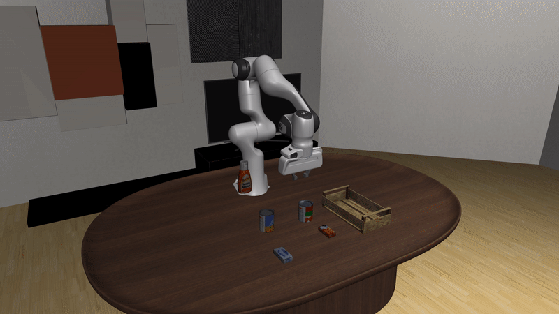

# LIBERO Post-Training

Raise a frozen policy's success rate on a LIBERO tabletop task by steering it with reinforcement learning, leaving the policy's weights untouched.
GR00T N1.7 steered with DSRL is the reference recipe; pi0 and DreamZero run through the same launcher.
The launcher also trains GR00T N1.7 or pi0 offline with SFT or IQL.
The workflow lives in `example_workflows/libero_posttraining/`.



A successful episode of the LIBERO-90 task "pick up the cream cheese and put it in the tray" (`LIVING_ROOM_SCENE3`), from the frozen pi0 policy without steering.

LIBERO is a MuJoCo tabletop benchmark with a Franka Panda arm: four suites of ten language-conditioned tasks (LIBERO-Spatial, LIBERO-Object, LIBERO-Goal and the long-horizon LIBERO-10), plus the ninety-task LIBERO-90.
It steps inside the learner process, so there are no simulator servers.
Steering needs no training dataset.

## Requirements

| | |
|---|---|
| Hardware | one NVIDIA GPU with 48 GB of memory, shared by the policy and the renderer (enough for GR00T N1.7, pi0 and the 5B DreamZero); installation and the first two smoke checks need no GPU |
| Operating system | Linux on x86_64; the `apt` commands assume Ubuntu or Debian and need `sudo` |
| Driver | an NVIDIA driver for CUDA 12.8 or newer (`nvidia-smi` shows it) with EGL for headless rendering; the PyTorch wheels bring their own CUDA libraries |
| Software | `git` and `uv` (`curl -LsSf https://astral.sh/uv/0.11.19/install.sh \| sh`; see the [installation page](../installation.md#prerequisites)) |
| Accounts | a Hugging Face account that has accepted the terms of the gated `nvidia/Cosmos-Reason2-2B`, needed by GR00T N1.7. Weights & Biases is optional: export `WANDB_API_KEY`, or append `logging.wandb_offline=true` to a training command |
| Disk | about 30 GB for the GR00T path plus run outputs; pi0 adds about 12 GB and DreamZero about 25 GB |
| Time | under two minutes for the smoke check; a few minutes for the pre-flight evaluation; 2 to 5 minutes per 20-episode task for the frozen GR00T evaluation; several hours for a 100,000-step steering run |

The commands below check out the commits pinned in `example_workflows/libero_posttraining/externals.lock.yaml`.
The paths under `$HOME` are defaults; any location works if you change them consistently.

## Installation

### Install LIBERO

LIBERO pins `numpy` below 2 and the legacy `gym`, which conflict with this repository's environment.
It therefore gets a second, Python 3.11 environment, and the launchers run in it.

1. Clone and install this repository; every later command runs from its root:

   ```bash
   git clone https://github.com/nvidia-isaac/isaac-rlpt.git
   cd isaac-rlpt
   uv sync
   ```

2. Install the system GL libraries (rendering and OpenCV) and a C compiler (robosuite's `evdev` dependency compiles from source):

   ```bash
   sudo apt install -y libegl1 libgl1 libglib2.0-0 build-essential
   ```

3. Clone LIBERO at the pinned revision and add the empty `__init__.py` that `import libero` needs after an editable install:

   ```bash
   export LIBERO_ROOT=$HOME/LIBERO
   git clone https://github.com/Lifelong-Robot-Learning/LIBERO "$LIBERO_ROOT"
   git -C "$LIBERO_ROOT" checkout 8f1084e3132a39270c3a13ebe37270a43ece2a01
   touch "$LIBERO_ROOT/libero/__init__.py"
   ```

4. Create the LIBERO environment and install the simulator, LIBERO and this repository into it:

   ```bash
   export LIBERO_VENV=$HOME/libero-venv
   uv venv --python 3.11 "$LIBERO_VENV"
   source "$LIBERO_VENV/bin/activate"
   uv pip install --no-config "numpy==1.26.4" "robosuite==1.4.1" "bddl==1.0.1" "mujoco==2.3.7" \
       "gym==0.25.2" "pyarrow<26" gymnasium pyyaml matplotlib easydict opencv-python-headless future
   uv pip install --no-config -e "$LIBERO_ROOT"
   uv pip install --no-config -e .
   ```

   `pyarrow<26` is needed because `pyarrow` 26 requires NumPy 2.
   Every `uv pip install` into the LIBERO environment carries `--no-config`, so `uv` ignores this repository's package settings.

5. Give this checkout its own LIBERO config; without it, LIBERO's first import blocks on an interactive prompt:

   ```bash
   export LIBERO_CONFIG_PATH=$LIBERO_VENV/libero_config
   mkdir -p "$LIBERO_CONFIG_PATH"
   cat > "$LIBERO_CONFIG_PATH/config.yaml" <<EOT
   benchmark_root: $LIBERO_ROOT/libero/libero
   bddl_files: $LIBERO_ROOT/libero/libero/bddl_files
   init_states: $LIBERO_ROOT/libero/libero/init_files
   assets: $LIBERO_ROOT/libero/libero/assets
   datasets: $LIBERO_ROOT/datasets
   EOT
   ```

6. In every new shell, restore the environment from the repository root before running anything below (add `GR00T_CKPT` from the next section once you have it):

   ```bash
   cd isaac-rlpt
   export LIBERO_ROOT=$HOME/LIBERO LIBERO_VENV=$HOME/libero-venv
   source "$LIBERO_VENV/bin/activate"
   export LIBERO_CONFIG_PATH=$LIBERO_VENV/libero_config MUJOCO_GL=egl
   export LD_LIBRARY_PATH=$LIBERO_VENV/lib/python3.11/site-packages/nvidia/cudnn/lib:$LD_LIBRARY_PATH
   ```

   `MUJOCO_GL=egl` renders headless; `MUJOCO_GL=osmesa`, after `sudo apt install libosmesa6`, is the software fallback.
   The `LD_LIBRARY_PATH` line makes torch use the environment's cuDNN rather than a system cuDNN of another version.
   The launchers run the `python3` on `PATH`, here the LIBERO environment's; `LEARNER_PYTHON` overrides that.

### Install the policy stack

Install only the stack of the policy you steer, into the LIBERO environment.
GR00T N1.7 is the reference.

#### GR00T N1.7

1. Clone Isaac-GR00T at the pinned revision and install its inference stack (torch 2.9.0, no flash-attn).
   Isaac-GR00T declares Python 3.12 only, but `mujoco==2.3.7` has no 3.12 wheel; the code runs on 3.11, so the `sed` line widens the declared range.

   ```bash
   export GR00T_ROOT=$HOME/Isaac-GR00T
   git clone https://github.com/NVIDIA/Isaac-GR00T "$GR00T_ROOT"
   git -C "$GR00T_ROOT" checkout 51d4c89f72fda44cbf77285c6a8114b52676b8a1
   sed -i 's/^requires-python = .*/requires-python = ">=3.10,<3.12"/' "$GR00T_ROOT/pyproject.toml"
   uv pip install --no-config "torch==2.9.0" "torchvision==0.24.0"
   uv pip install --no-config "transformers==4.57.3" "numpy==1.26.4" \
       "diffusers==0.35.1" "peft==0.17.1" "albumentations==1.4.18" "huggingface-hub[cli]" \
       dm-tree einops tyro omegaconf pandas msgpack msgpack-numpy termcolor lmdb
   uv pip install --no-config -e "$GR00T_ROOT" --no-deps
   ```

2. Accept the terms of the gated `nvidia/Cosmos-Reason2-2B` backbone on its Hugging Face page, then log in:

   ```bash
   hf auth login                                      # or export HF_TOKEN=<your token>
   ```

3. Download one suite of `nvidia/GR00T-N1.7-LIBERO` (about 7 GB instead of 40) and keep the suite folder's path in `GR00T_CKPT`:

   ```bash
   export GR00T_SNAPSHOT=$(python -c '
   from huggingface_hub import snapshot_download
   print(snapshot_download(
       "nvidia/GR00T-N1.7-LIBERO",
       allow_patterns=["libero_10/*"],
       ignore_patterns=["*global_step*", "*rng_state*", "*optim_states*", "*scheduler.pt", "*training_args.bin", "*.pth"],
   ))')
   export GR00T_CKPT=$GR00T_SNAPSHOT/libero_10        # the suite folder, not the snapshot root
   ls "$GR00T_CKPT"                                   # config.json and the model weights
   ```

   Add `GR00T_CKPT` to the per-shell block; running `snapshot_download` again returns the cached path.

#### pi0

Clone the `dsrl_openpi` fork, whose policy accepts the steering noise, and install it with its client package (`GIT_LFS_SKIP_SMUDGE=1` skips the large Git LFS files of its LeRobot dependency):

```bash
export OPENPI_ROOT=$HOME/dsrl_openpi
git clone https://github.com/jesbu1/dsrl_openpi "$OPENPI_ROOT"
git -C "$OPENPI_ROOT" checkout b0e3cfbfb1fb46622b4d499fbeeada95d247f4a4
GIT_LFS_SKIP_SMUDGE=1 uv pip install --no-config -e "$OPENPI_ROOT"
uv pip install --no-config -e "$OPENPI_ROOT/packages/openpi-client"
uv pip install --no-config "mujoco==3.3.1" "gcsfs==2025.10.0"
```

Install the MuJoCo upgrade last: under `2.3.7` pi0 succeeds on the reference task 2 to 4 percent of the time instead of about 33.
Pin `gcsfs` as shown; newer versions stall the checkpoint download outside Google Cloud.
The first run fetches the `pi0_libero` checkpoint (about 12 GB) from `gs://openpi-assets/checkpoints/pi0_libero/`.

#### DreamZero

First use downloads the `google/umt5-xxl` tokenizer.

```bash
export DREAMZERO_ROOT=$HOME/dreamzero
git clone https://github.com/dreamzero0/dreamzero "$DREAMZERO_ROOT"
git -C "$DREAMZERO_ROOT" checkout ab790c198fbce33503358efbbd4187ce9a89adf3
uv pip install --no-config -e ".[dreamzero-local]"
uv pip install --no-config -e "$DREAMZERO_ROOT" --no-deps
hf download RLinf/RLinf-DreamZero-WAN2.2-5B-LIBERO-SFT-Step26000 --local-dir "$HOME/dreamzero-libero-ckpt"
```

#### Parallel runtimes (optional)

`RUNTIME=rlinf` runs the simulators as RLInf rollout workers from this same environment, which keeps its torch 2.9.0:

```bash
uv pip install --no-config -e ".[rlinf]"
```

On one GPU, add `runtime.rlinf.first_accelerator=0 runtime.rlinf.exclusive_accelerators=false` to the launcher command; otherwise the plan check expects a second GPU for the rollout workers.
A small DSRL run this way peaks near 16 GiB of GPU memory and a small PPO run near 9 GiB.
Two PPO learner ranks (`PPO_LEARNER_RANKS=2`) need two GPUs.
RLInf's workers do not read the Hugging Face token file, so export `HF_TOKEN=$(cat ~/.cache/huggingface/token)` before launching, or the gated backbone fails with 401.

## Smoke check

Run the three checks in order; each covers more of the stack than the last.

1. **Launcher check, no GPU, no LIBERO.** In the repository's own environment, resolve every launcher's plan against a placeholder checkpoint and check the results table; no model or simulator loads:

   ```bash
   uv run bash example_workflows/libero_posttraining/smoke.sh
   ```

   It passes in under two minutes when the last line is `smoke check passed`.

2. **Simulator check, no GPU.** In the LIBERO environment, import the stack and reset one task (the first reset takes about 30 seconds):

   ```bash
   python -c "import libero.libero, mujoco, robosuite; print(mujoco.__version__)"
   python -c "
   from simulators.libero.env import LiberoEnv
   env = LiberoEnv(suite='libero_spatial', task_id=0, image_size=256, seed=0)
   obs, info = env.reset(seed=0)
   print(obs['agentview_image'].shape, obs['state'].shape, obs['prompt'])
   env.close()"
   ```

   It passes when the first command prints `2.3.7` (`3.3.1` once the pi0 stack is installed) and the second prints `(256, 256, 3) (9,) pick up the black bowl between the plate and the ramekin and place it on the plate`.

3. **Pre-flight evaluation, one GPU.** Run two episodes of the frozen GR00T N1.7 policy on one LIBERO-10 task, which loads the checkpoint, backbone, renderer and simulator together:

   ```bash
   CUDA_VISIBLE_DEVICES=0 python example_workflows/libero_posttraining/scripts/eval.py \
       --checkpoint "$GR00T_CKPT" --suite libero_10 --tasks 8 --episodes 2 \
       --output-dir logs/libero_preflight
   ```

   It passes when it prints `[eval_libero] task 8 done in <seconds>s: <successes>/2 (<rate>)` and ends with `[eval_libero] wrote logs/libero_preflight/results.jsonl and logs/libero_preflight/results.md`; any success count passes.
   A `flash_attn is not installed` warning is expected.

## Training

GR00T N1.7 steered with DSRL on one LIBERO-10 task, 100,000 environment steps with a 50-episode evaluation every 5,000:

```bash
POSTTRAIN_BASE_CKPT=$GR00T_CKPT GPU=0 \
  bash example_workflows/libero_posttraining/scripts/train.sh KITCHEN_SCENE8_put_both_moka_pots_on_the_stove
```

`GPU` is the CUDA device index.
The task is a name or its index in the suite.
`SUITE` defaults to `libero_10`; the others are `libero_spatial`, `libero_object` and `libero_goal`, each with its own suite folder of the checkpoint.

The same task with PPO instead of SAC, named by index (DSRL-PPO supports `BASE_MODEL=gr00t` only):

```bash
POSTTRAIN_BASE_CKPT=$GR00T_CKPT GPU=0 \
  bash example_workflows/libero_posttraining/scripts/train_ppo.sh 8
```

pi0 on the DSRL paper's LIBERO-90 task, with the paper's recipe as overrides:

```bash
TASK=LIVING_ROOM_SCENE3_pick_up_the_cream_cheese_and_put_it_in_the_tray
POSTTRAIN_BASE_CKPT=gs://openpi-assets/checkpoints/pi0_libero/ GPU=0 BASE_MODEL=pi0 TRAIN_MAXSTEPS=400 \
  bash example_workflows/libero_posttraining/scripts/train.sh "$TASK" "env.env_name=libero_pi0/libero_90/$TASK" \
    training.chunk_size=50 env.critic_image_size=64 \
    model.image_encoder_type=impala model.impala_use_smaller=true model.impala_bounded_head=true \
    algorithm.augment_pixels=true algorithm.augment_color_jitter=true \
    algorithm.critic_target_reduction=mean algorithm.critic_reduction=mean \
    algorithm.n_critics_to_sample=10 algorithm.pooled_critic_features=true
```

DreamZero steered with DSRL on LIBERO-Spatial task 0, with the RLinf-validated recipe (`RECIPE=pixel` selects the reference's pixel encoders):

```bash
POSTTRAIN_BASE_CKPT=$HOME/dreamzero-libero-ckpt GPU=0 BASE_MODEL=dreamzero_local SUITE=libero_spatial \
  bash example_workflows/libero_posttraining/scripts/train.sh 0
```

Offline IQL (or `ALGO=sft`) of GR00T N1.7 itself from a LeRobot demonstration dataset ([IQL](../algorithms/iql.md), [SFT](../algorithms/sft.md)); `BASE_MODEL=pi0` trains pi0 instead:

```bash
ALGO=iql POSTTRAIN_BASE_CKPT=$GR00T_CKPT POSTTRAIN_DATASET_DIR=<lerobot demos> GPU=0 \
  bash example_workflows/libero_posttraining/scripts/train.sh 8
```

`NUM_ROLLOUTS` then counts updates (40,000 by default), and the run evaluates the policy every 5,000 updates on 50 episodes.
SFT and IQL are not yet tested end to end in this release.

**Launcher variables** (the script header lists all of them).
Any trailing `key=value` is a Hydra override, and `ISAAC_RL_POSTTRAINING_DRYRUN=1` in front prints the resolved plan and exits:

| Variable | Default | Meaning |
|---|---|---|
| `BASE_MODEL` | `gr00t` | `gr00t`, `pi0`, `dreamzero_local` |
| `ALGO` | `dsrl_sac` | `dsrl_sac`, `rfs`, `sac_edit`, `dsrl_ppo`, `sft`, `iql` (`sft` and `iql` untested) |
| `POSTTRAIN_DATASET_DIR` | none | the LeRobot dataset `sft` and `iql` train on |
| `SUITE` | `libero_10` | LIBERO benchmark suite |
| `SIMULATOR` | `$SUITE` | simulator config the episode cap is read from |
| `GPU`, `GPUS` | 0, `$GPU` | CUDA device for the learner and the renderer; `GPUS` lists every device the runtime sees |
| `NUM_ROLLOUTS` | 100000 | environment-step budget; updates for `sft` and `iql` (default 40000) |
| `TRAIN_MAXSTEPS` | the simulator config's | episode cap; 720 under the GR00T reference protocol |
| `NUM_ENVS`, `RUNTIME` | 1, `native` | `NUM_ENVS=8 RUNTIME=rlinf` runs eight simulators in parallel; needs the RLInf extra |
| `LOG_DIR`, `ISAAC_RL_POSTTRAINING_OUTPUT_DIR` | `./dsrl_train_logs`, `~/isaac_rl_outputs` | where logs and checkpoints land |
| `WANDB_NAME` | `<algo>_libero_<task>_<timestamp>` | Weights & Biases run name |

### Python API

The first training command as a Python call; LIBERO steps inside the learner, so this is the whole run:

```python
import os

from isaac_rl_posttraining import Env, train
from isaac_rl_posttraining.algorithms import DSRL, BaseModel

base = BaseModel("gr00t", os.environ["GR00T_CKPT"], embodiment_tag="libero_sim")
train(
    DSRL(base=base, noise_dim=7, action_exec_len=8),
    env=Env(
        "libero/libero_10/8",
        simulator="libero_10",
        max_episode_steps=720,
        image_keys=["video.image"],
    ),
    overrides=["training.num_rollouts=100000", "eval.eval_max_steps=200"],
)
```

`run.py` holds this recipe (`uv run python -m example_workflows.libero_posttraining.run 8 --dry-run` prints its plan); `DSRLPPO(base=base)` in place of `DSRL(...)` gives the run of `train_ppo.sh`.

## Evaluation

The frozen GR00T N1.7 policy on every task of a suite, 20 episodes per task (the reference protocol):

```bash
CUDA_VISIBLE_DEVICES=0 python example_workflows/libero_posttraining/scripts/eval.py \
    --checkpoint "$GR00T_CKPT" --suite libero_10 --episodes 20 \
    --output-dir logs/libero_eval
```

It writes one line per task to `logs/libero_eval/results.jsonl` and a `results.md` report.
A trained steering actor is scored by its run's in-training evaluations; LIBERO has no separate re-scoring launcher.

## Outputs

| Output | Where |
|---|---|
| Learner log | `./dsrl_train_logs/<run name>.train.log`; `LOG_DIR` moves it |
| Checkpoints and evaluation videos | `~/isaac_rl_outputs/<run name>_<timestamp>/` (`checkpoints/`, `evaluation_videos/`); `ISAAC_RL_POSTTRAINING_OUTPUT_DIR` moves them |
| Every evaluation | `checkpoints/evaluation_summary.json`, under `history` with one entry per evaluation (`step`, `success_rate`, `num_eval_episodes`) |
| Metrics | Weights & Biases; `logging.wandb_project=...` picks the project |
| Frozen-policy evaluation | `logs/libero_eval/results.jsonl` and `results.md` |

The run name is `WANDB_NAME`, for example `dsrl_sac_libero_KITCHEN_SCENE8_put_both_moka_pots_on_the_stove_<timestamp>`.
Training evaluates once before the first update (step 0) and then the stochastic steering policy every 5,000 steps on 50 episodes, with evaluation workers seeded 1000 apart from the training ones.
Each evaluation logs a pair of lines like these:

```text
INFO | isaac_rl_posttraining.training.off_policy:_run_scheduled_evaluation:505 - Starting evaluation at step 5004 (episode 10)
INFO | isaac_rl_posttraining.training.off_policy:_print_detailed_eval_metrics:694 - [EVAL] Success Rate: 62.0%
```

A single 50-episode evaluation scatters by about 7 points, so compare runs over several evaluations.

## Results

<!-- results: libero_posttraining -->

The DSRL and RFS rows steer the frozen pi0 on the LIBERO-90 cream-cheese task (the pi0 command above); the DSRL-PPO row is the LIBERO-10 run below.
Each row is one training run, so a reproduction can differ by more than the sampling noise of a 50-episode evaluation.
Other measurements, including the pi0 training curve, are in `simulators/libero/README.md`.
To add a row, edit `example_workflows/libero_posttraining/results/results.json` and regenerate the README table with `example_workflows._common.results_table`.

### DSRL-PPO on LIBERO-10 task 8

One `dsrl_ppo` run of the `train_ppo.sh` command above with `RUNTIME=rlinf`: 16 rollout workers, one shared GR00T N1.7 policy server and one learner rank on two NVIDIA RTX 6000 Ada GPUs.
The 64-episode in-training evaluations scored 49, 49 and 51 successes at iterations 5, 10 and 15, against 46 for the frozen policy.
On the same seeds, the iteration-20 checkpoint turns 12 of the frozen policy's failures into successes and 7 successes into failures.
A training iteration took about 187 s, almost all of it in the shared policy server.

## Reference

**Base policies**, each frozen:

| `BASE_MODEL=` | Policy | Checkpoint |
|---|---|---|
| `gr00t` (default) | GR00T N1.7 | one suite folder of `nvidia/GR00T-N1.7-LIBERO` on Hugging Face, about 7 GB |
| `pi0` | Physical Intelligence's pi0 through the `dsrl_openpi` fork | `pi0_libero`, downloaded on first use from `gs://openpi-assets/checkpoints/pi0_libero/`, about 12 GB |
| `dreamzero_local` | DreamZero | `RLinf/RLinf-DreamZero-WAN2.2-5B-LIBERO-SFT-Step26000` on Hugging Face, a LIBERO-Spatial checkpoint |

**Reward.** The GR00T recipe gives 0 on success and -1 when the episode fails or hits the cap.
The pi0 and DreamZero recipes give -1 per step and 0 on the success step.

**Success and the cap.** Success is the task's BDDL goal predicate.
An episode ends on success or at the cap, 720 steps under the GR00T reference protocol.

## Common issues

LIBERO failures and fixes are in [troubleshooting](../troubleshooting.md#libero).

## Related pages

- Algorithms: [DSRL](../algorithms/dsrl.md), [RFS](../algorithms/rfs.md), [SAC-edit](../algorithms/sac_edit.md), [PPO](../algorithms/ppo.md), [IQL](../algorithms/iql.md), [SFT](../algorithms/sft.md)
- LIBERO failures and fixes: [troubleshooting.md](../troubleshooting.md)
