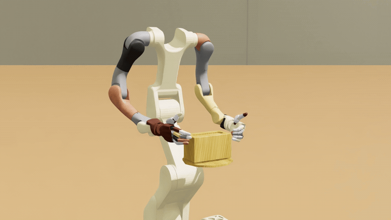

# Video-to-Data (V2D) Tissue Box Post-Training

Train a Vega/Sharpa robot to lift and hold a tissue box, using DSRL to steer a frozen GR00T policy learned from human videos.
DSRL learns a small steering policy; the pretrained weights never change.
The workflow lives in `example_workflows/v2d_box_lift_posttraining/`; Docker is the supported way to run it.

**Note:** this workflow has not been fully tested. It has only been run with an NVIDIA 580-series driver (580.95.05); the Video-to-Data image runs Isaac Sim 5.1, which does not support newer drivers such as the 595 series.



A successful episode in real time, from the frozen Video-to-Data tissue-box GR00T policy without steering.

## Overview

- **Simulator:** [Video-to-Data v0.4.0](https://github.com/nvidia-isaac/video_to_data/releases/tag/v0.4.0), packaged with Isaac Sim / Isaac Lab in Docker.
- **Base policy:** the [Video-to-Data tissue-box GR00T checkpoint](https://huggingface.co/nvidia/video-to-data-GR00T-N1.7-finetuned-tissue-box-lift), which controls 58 Vega/Sharpa joint positions.
  It predicts 16 actions at a time (the J0_N16 configuration), and the workflow executes four before predicting again.
- **Task:** lift and hold a tissue box over a 550-step episode.
  The box starts within ±1 cm in X/Y; each environment keeps its placement and randomized appearance across episodes.
  Training and evaluation both use `example_workflows/v2d_box_lift_posttraining/configs/tasks/tissue_box_lift_hold_xy_1cm_550_fixed.json`.
- **Success:** lift at least 10 cm, hold at least 5 cm above the start for 20 consecutive samples, and end no more than 1 cm below the start.
  Success earns reward 1 and failure 0, in training and evaluation.

## Requirements

| | |
|---|---|
| Hardware | an NVIDIA RTX-class GPU with at least 48 GB of memory, such as an L40S (48 GB) or RTX PRO 6000 Blackwell (96 GB); larger batches need more memory |
| OS and driver | Ubuntu 24.04 LTS on x86-64 with an NVIDIA 580-series driver (tested with 580.95.05); the image brings its own CUDA libraries; the Video-to-Data image runs Isaac Sim 5.1, which does not support newer drivers such as the 595 series; Ubuntu 22.04 LTS and older drivers are untested |
| Software | Docker with Buildx, the [NVIDIA Container Toolkit](https://docs.nvidia.com/datacenter/cloud-native/container-toolkit/latest/install-guide.html), and Git. The image brings Video-to-Data, Isaac Sim / Isaac Lab, GR00T and CUDA |
| Optional | [uv](https://docs.astral.sh/uv/getting-started/installation/) for the CPU check; see [Installation](../installation.md) |
| Model access | a Hugging Face read token with access to the gated `nvidia/Cosmos-Reason2-2B` backbone (step 4) |
| Disk | room for the image, build cache and checkpoint under the cache directory (default `~/data_drive/v2d-posttraining`) |
| Weights & Biases | not needed; every command here logs offline |

## Installation and training with Docker

1. Check the driver, and that Docker can build images and reach the GPU:

   ```bash
   nvidia-smi --query-gpu=name,driver_version,memory.total --format=csv
   docker buildx version
   docker run --rm --gpus all ubuntu nvidia-smi
   ```

   The first prints your GPU, its driver version (a 580-series driver; 595 and newer are not supported) and its memory.
   The last prints your GPU table from inside a container; if it fails, install or reconfigure the NVIDIA Container Toolkit.

2. Clone this repository and enter it; every later command runs from here:

   ```bash
   git clone https://github.com/nvidia-isaac/isaac-rlpt.git
   cd isaac-rlpt
   ```

   Use `git clone`, not a downloaded archive: the image build reads the checkout's commit.

3. Optional, if you have uv: check the launcher without a GPU, model or simulator:

   ```bash
   uv sync
   uv run bash example_workflows/v2d_box_lift_posttraining/smoke.sh
   ```

   It ends with `V2D box-lift workflow smoke check passed`.

4. Get Hugging Face access once, before the first build, so an access problem shows up now rather than after the build.
   Sign in at [huggingface.co](https://huggingface.co/join).
   Accept the license of [nvidia/Cosmos-Reason2-2B](https://huggingface.co/nvidia/Cosmos-Reason2-2B), and create a **Read** token at [huggingface.co/settings/tokens](https://huggingface.co/settings/tokens).
   Enter the token at the prompt, so it stays out of your shell history, and check that it reads both repositories:

   ```bash
   read -rsp 'Hugging Face token: ' HF_TOKEN && export HF_TOKEN && echo
   for repo in nvidia/video-to-data-GR00T-N1.7-finetuned-tissue-box-lift/resolve/e3ad7eb8dcde2e667a8b5ef9c46d1c66aa0dc9aa \
               nvidia/Cosmos-Reason2-2B/resolve/main; do
     curl -sfL -r 0-0 -o /dev/null -H "Authorization: Bearer $HF_TOKEN" "https://huggingface.co/$repo/config.json" \
       && echo "ok      ${repo%%/resolve/*}" || echo "DENIED  ${repo%%/resolve/*}"
   done
   ```

   Both lines should start with `ok`.
   `DENIED` means the token is wrong or lacks read permission, or access has not been granted yet.
   The container reads only `HF_TOKEN`, not a login saved by `hf auth login`.

5. Start a short training run:

   ```bash
   bash example_workflows/v2d_box_lift_posttraining/scripts/docker_train.sh \
     --gpus 0 \
     --output-dir "$HOME/data_drive/v2d-posttraining/runs/run-001" \
     -- --training-steps 2000 --override logging.wandb_offline=true
   ```

   The first launch builds the image and downloads the checkpoint; later launches reuse both from the cache.
   If pulling Video-to-Data's Isaac Lab base image fails with an authentication error, run `docker login nvcr.io` with the user name `$oauthtoken` and an [NGC API key](https://org.ngc.nvidia.com/setup/api-key) as the password, then rerun.
   This run uses one GPU and one simulation environment, with evaluation disabled; 2,000 steps only checks that training starts.

### Outputs

Training logs report progress and success rate.
The output directory holds:

| Output | Location |
|---|---|
| Checkpoints and training outputs | `run/run_outputs/` |
| Simulator logs | `run/runtime/` |
| Local Weights & Biases logs | `run/wandb/` |

Use a fresh output directory for every run.
Before any GPU work, the launcher refuses an existing output directory, a checkpoint that is not the 58-joint policy, a Video-to-Data checkout other than the required release, and an evaluation episode count that is not a multiple of the environment count.

### Docker configuration

Options before `--` configure Docker; options after it go to the workflow launcher ([Configuration](#configuration)).

| Option | Meaning |
|---|---|
| `--gpus 0` | which GPUs to use; `--gpus 0,1` puts the learner on the first and the simulator on the second |
| `--output-dir PATH` | a fresh directory for this run's outputs (required) |
| `--cache-dir PATH` | the persistent build, model and checkpoint cache |
| `--build` | rebuild after updating this repository, including when upgrading from an earlier Video-to-Data release |
| `--image IMAGE` | use a supplied image, pulling it if it is not local |
| `--dry-run` | print the Docker command without building or launching |

To build the image ahead of time, or after changing the Dockerfiles, run `bash example_workflows/v2d_box_lift_posttraining/scripts/docker_build.sh`.

### Evaluation in Docker

To evaluate during training, select three GPUs with `--gpus 0,1,2` and add `--evaluation-mode enabled --eval-num-episodes 10` after `--`.
The third GPU runs the evaluation simulator.
The run scores the frozen policy first, then the steering policy on the same cases as training progresses.

On one GPU, score the frozen policy in a separate run: add `--native --evaluation-mode enabled --eval-num-episodes 10` after `--` and use a fresh output directory.

## Installation and training without Docker

Use this path only if you already have an Isaac Sim / Isaac Lab installation; the Video-to-Data v0.4.0 container builds on Isaac Lab 2.3.2.
Run every step from the repository root.

1. Install Git LFS (`git lfs version` should print a version) and this repository with the CUDA extra, which brings the torchvision GR00T N1.7 imports:

   ```bash
   uv sync --extra cuda
   ```

2. Set up the Video-to-Data simulator by following the [Video-to-Data v0.4.0 setup instructions](https://github.com/nvidia-isaac/video_to_data/tree/v0.4.0/robotic_grounding).

3. Install GR00T at the container's pin without its own dependency pins (they need Python 3.10 and torch 2.7.1), then the learner packages this environment does not already pin:

   ```bash
   git clone https://github.com/NVIDIA/Isaac-GR00T.git
   git -C Isaac-GR00T checkout ab88b50c718f6528e1df9dcbaf75865d1b604760
   uv pip install --no-deps -e Isaac-GR00T
   grep -vE '^(#|torch|torchvision|numpy|transformers|huggingface-hub|torchcodec|opencv-python=)' \
     example_workflows/v2d_box_lift_posttraining/docker/requirements-learner.txt > learner-extra.txt
   uv pip install -r learner-extra.txt
   ```

4. With `HF_TOKEN` exported (step 4 of the Docker path), clone the Video-to-Data release with its motion data and download the checkpoint:

   ```bash
   export V2D_ROOT="$HOME/data_drive/v2d-posttraining/video_to_data"
   GIT_LFS_SKIP_SMUDGE=1 git clone --branch v0.4.0 \
     https://github.com/nvidia-isaac/video_to_data.git "$V2D_ROOT"
   git -C "$V2D_ROOT" lfs install --local
   git -C "$V2D_ROOT" lfs pull --include='robotic_grounding/**'

   export POSTTRAIN_BASE_CKPT="$HOME/data_drive/v2d-posttraining/checkpoint"
   uv run hf download nvidia/video-to-data-GR00T-N1.7-finetuned-tissue-box-lift \
     --revision e3ad7eb8dcde2e667a8b5ef9c46d1c66aa0dc9aa \
     --local-dir "$POSTTRAIN_BASE_CKPT"
   ```

5. Set the remaining paths both launchers require.
   Edit `V2D_SIM_PYTHON` to the `python.sh` of your Isaac Sim installation (an Isaac Lab checkout links it as `_isaac_sim/python.sh`):

   ```bash
   export V2D_MOTION_FILE="$V2D_ROOT/robotic_grounding/source/robotic_grounding/robotic_grounding/assets/human_motion_data/ego_recon/processed/sequence_id=tissue_box_simple/robot_name=vega_sharpa/data.parquet"
   export V2D_SIM_PYTHON="$HOME/IsaacLab/_isaac_sim/python.sh"   # edit
   export POSTTRAIN_OUTPUT_DIR="$HOME/data_drive/v2d-posttraining/runs/manual-001"
   test -x "$V2D_SIM_PYTHON" && test -f "$V2D_MOTION_FILE" && echo "paths ok"
   ```

   The last line prints `paths ok`.
   The launchers stop immediately if any of the five variables is unset.

6. Check the launcher, then start a short training run:

   ```bash
   uv run bash example_workflows/v2d_box_lift_posttraining/smoke.sh
   uv run bash example_workflows/v2d_box_lift_posttraining/scripts/train.sh \
     --num-train-envs 1 --train-device cuda:0 --training-steps 2000 \
     --override logging.wandb_offline=true
   ```

   The launcher starts the simulators, then the learner.
   Outputs go directly under `POSTTRAIN_OUTPUT_DIR`, without Docker's extra `run/` directory.
   `--dry-run` prints the plan as JSON and the learner's `plan.*` lines, and starts nothing.

### Python API

With the simulators already listening, the learner is also a Python run handle with the same config:

```python
from example_workflows.v2d_box_lift_posttraining import launch as v2d
from isaac_rl_posttraining import launch

args = v2d.parser().parse_args([
    "--v2d-root", ..., "--checkpoint", ..., "--motion-file", ...,
    "--sim-python", ..., "--output-dir", ...,
])
plan = v2d.resolve_plan(args)
algorithm, env, overrides = v2d.learner_recipe(plan)  # DSRL(base="gr00t") and the launcher's settings
run = launch(algorithm, env=env, overrides=overrides)  # export v2d.learner_environment(plan) first
run.loop()
```

`example_workflows/v2d_box_lift_posttraining/tests/test_golden_config.py` checks that this run and the launcher's learner compose the same config.

### Checkpoint evaluation

Score the frozen policy and a steering checkpoint one after the other, in separate output directories; each starts its own simulator server on the same default port:

```bash
POSTTRAIN_OUTPUT_DIR="$HOME/data_drive/v2d-posttraining/runs/eval-native" \
uv run bash example_workflows/v2d_box_lift_posttraining/scripts/eval.sh native \
  --eval-device cuda:0 --eval-num-envs 1 --eval-num-episodes 10 \
  --override logging.wandb_offline=true

STEERING_CKPT=$(ls -d "$HOME"/data_drive/v2d-posttraining/runs/manual-001/run_outputs/*/checkpoints/final | tail -n 1)
POSTTRAIN_OUTPUT_DIR="$HOME/data_drive/v2d-posttraining/runs/eval-steered" \
uv run bash example_workflows/v2d_box_lift_posttraining/scripts/eval.sh steered "$STEERING_CKPT" \
  --eval-device cuda:0 --eval-num-envs 1 --eval-num-episodes 10 \
  --override logging.wandb_offline=true
```

`STEERING_CKPT` is the final checkpoint of the training run above; point it at any other checkpoint directory to score that one.
Each run writes `evaluation_episodes.jsonl` under `run_outputs/`; compare the two:

```bash
uv run python -m example_workflows.v2d_box_lift_posttraining.compare_native \
  "$(find "$HOME/data_drive/v2d-posttraining/runs/eval-native" -name evaluation_episodes.jsonl)" \
  "$(find "$HOME/data_drive/v2d-posttraining/runs/eval-steered" -name evaluation_episodes.jsonl)"
```

Both commands use the same evaluation seed and cases by default.
Ten episodes only check the setup.
For a comparison, raise the environment count (extra episodes on one environment reuse its fixed scene), keep the episode count a multiple of it, and use the same count and seed for every checkpoint.
A fixed seed does not make simulation or rendering identical, so repeat comparisons that differ by only a few successes.

## Results

<!-- results: v2d_box_lift_posttraining -->

No hardware benchmark has been published for this release.

## Configuration

These flags follow `example_workflows/v2d_box_lift_posttraining/scripts/train.sh`, or `--` on `docker_train.sh`.
The defaults are the launcher's; the container sets both simulator batch sizes to one.
`uv run python -m example_workflows.v2d_box_lift_posttraining.launch --help` lists every flag; `example_workflows/v2d_box_lift_posttraining/configs/recipe.yaml` holds the advanced training settings.

| Flag | Default | Meaning |
|---|---|---|
| `--num-train-envs` | 128 | environments in the training simulator |
| `--eval-num-envs` | 32 | parallel environments in the evaluation simulator |
| `--eval-num-episodes` | 32 | episodes per evaluation; a multiple of the evaluation environment count |
| `--evaluation-mode` | `disabled` | `enabled` evaluates the frozen policy, then the steering policy during training |
| `--native` | off | run only the frozen-policy baseline on the evaluation server |
| `--training-steps` | 704000 | total simulation steps across training environments |
| `--training-decode-batch-size` | 16 | training-only decoder micro-batch |
| `--training-cadence` | `step` | `step` learns between decisions; `episode` learns after a full round of every environment |
| `--updates-per-transition` | 1 | learner updates per collected transition |
| `--replay-batch-size` | 64 | replay minibatch |
| `--max-updates-per-burst` | 128 | cap on updates per training phase |
| `--seed`, `--eval-seed` | 2, 10000 | training and evaluation seeds |
| `--train-task-config`, `--eval-task-config` | the tissue-box task configuration | paths to custom task configurations |
| `--train-device`, `--eval-device` | `cuda:1`, `cuda:2` | which card each simulator runs on |
| `--train-port`, `--eval-port` | 5555, 5556 | server ports |
| `--startup-timeout-seconds` | 900 | how long to wait for a server |
| `--run-name` | `v2d-box-lift-dsrl` | run name |
| `--override KEY=VALUE` | none | an extra Hydra override; repeatable; workflow contract keys cannot be replaced |
| `--dry-run` | off | print the plan as JSON and start nothing |

## Related pages

- Algorithm: [DSRL](../algorithms/dsrl.md)
- When something fails: [troubleshooting.md](../troubleshooting.md)
