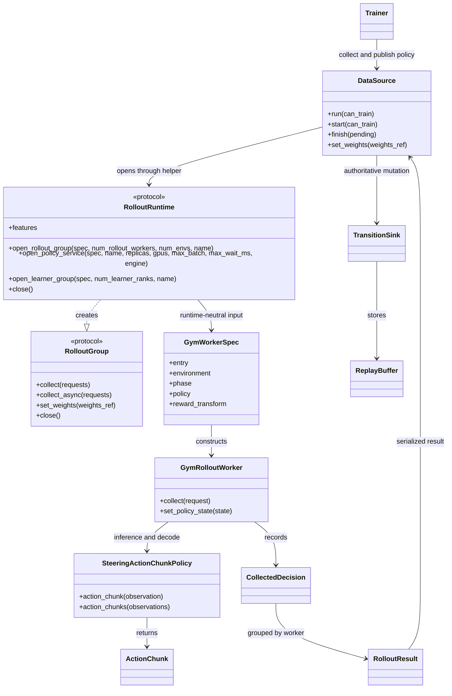
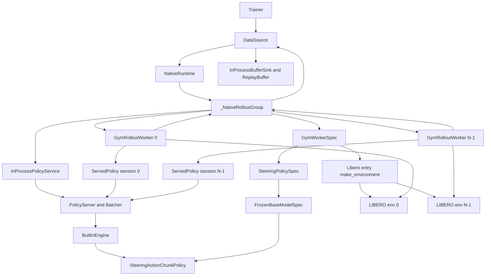
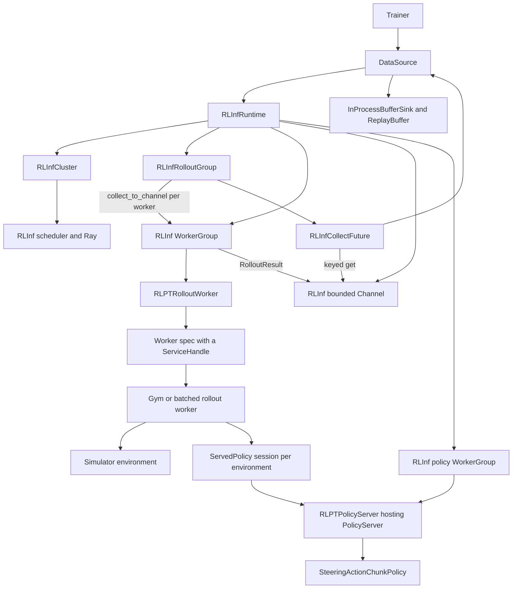
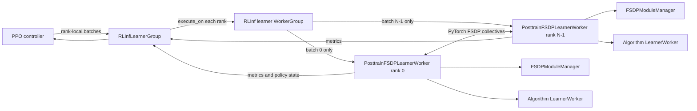

# Runtime class interactions

How the runtime classes call each other, and what data they exchange, for each runtime.
Choosing, installing and configuring a runtime is in [runtimes.md](runtimes.md).
Every runtime implements the same boundary; each runtime handles placement, transport and policy serving itself.
Selecting a runtime changes process placement, result transport, and whether policy inference is worker-local or shared; the simulator entry, `ActionChunk`, the reward transform, the transition records, the replay buffer and its samplers, the algorithm, the evaluation and the checkpoint formats do not change.

## Shared boundary

The training loop sees `DataSource`, `RolloutRuntime`, `RolloutGroup` and the serialized records.
The launch composes a `GymWorkerSpec` (or a `BatchedWorkerSpec`) from the simulator entry, the phase's environment description and a `PolicyRef`: either a policy spec each worker builds, or the `ServiceHandle` of a policy server; none of them imports a runtime package or Ray.



`ActionChunk` (`isaac_rl_posttraining/rollouts/action_chunk.py`) separates the learner action from the simulator action sequence.
`SparseOutcomeReward` (`isaac_rl_posttraining/runtimes/gym_worker.py`) is an optional `RewardTransform` selected by `env.sparse_success_reward`, so the reward stored by `GymRolloutWorker` matches the learning objective on every runtime.
`DataSource` (`isaac_rl_posttraining/training/data_source.py`) assigns globally unique episode identifiers, stamps each decision's lineage (source, worker, policy version and lag), drops decisions older than the schedule's `max_policy_lag`, writes the run's telemetry, and is the only runtime-side class that writes into the replay buffer.
Groups without a native `collect_async` or `set_weights` inherit them from `RolloutGroupBase` (`isaac_rl_posttraining/runtimes/concurrency.py`): a helper thread, and the resolved weights through `set_policy_state`.

### Workers and records

`RolloutRuntime.open_rollout_group(spec, num_rollout_workers=..., num_envs=..., name=...)` (`isaac_rl_posttraining/runtimes/base.py`) opens a `RolloutGroup` of workers; the environment indices are partitioned over the workers, and every collected decision records its environment index.
The protocol also has `open_policy_service(spec, name=...)`, `open_learner_group(spec, num_learner_ranks=..., name=...)`, `features` and `close()`.
Every runtime implements all of them; one without a capability raises `NotImplementedError` from the method and declares it in `features` (`standalone_policy_service`, `distributed_learner`), and `create_runtime` refuses a runtime class that omits a member.

Each worker receives a `RolloutWorkerContext` (`worker_index`, `num_rollout_workers`, `environment_indices`, `device`) and builds its environments through the simulator entry's `make_environment(spec, phase, context)`.
A `GymWorkerSpec` (`isaac_rl_posttraining/runtimes/gym_worker.py`) gives every worker one environment; a `BatchedWorkerSpec` (`isaac_rl_posttraining/runtimes/batched_worker.py`) lets one worker drive several in lockstep, taking the values that bootstrap a truncated episode from a value pass over the next observation (`bootstrap_values="evaluate_next_observation"`) or from the next decision (`"reuse_next_decision"`).
Worker specs travel to the workers by pickle; an entry the workers can import by name is pickled by reference, so nothing heavy is copied.

Every `RolloutRequest` carries a `mode`: `warmup` explores before learning starts, `train` acts with the learned policy and records what learning needs, and `eval` records outcomes only.
A request may also ask for `capture_frames` (video) and cap `max_decisions_per_episode`, so that a wedged simulator cannot stall an evaluation.
The acting policy returns an `ActionChunk`: the learner action (a steering latent, a residual, an edit or a denoising chain) next to the decoded environment actions, the execution length, the policy version and, for PPO, the behavior log-probability and value.
Workers return `CollectedDecision` records grouped in a `RolloutResult`, which the `DataSource` writes into the replay buffer and records in the run's telemetry.

### Trainers and policy families

The off-policy algorithms (DSRL, RFS, SAC-edit) train through `OffPolicyTrainer` (`isaac_rl_posttraining/training/off_policy.py`): the buffer stays with the controller, the algorithm draws each update's batches through its samplers, and `ReplayLearner` (`isaac_rl_posttraining/algorithms/replay_learner.py`) applies them on the learner.
The on-policy algorithms train through `OnPolicyTrainer` (`isaac_rl_posttraining/training/on_policy.py`), which keeps no buffer and builds its trajectories from the round's results.
Both collect through a `DataSource`, which also saves completed episodes when `data.persist.path` is set.
The rollout policy follows the algorithm's family (`isaac_rl_posttraining/runtimes/policy_families.py`): DSRL, RFS and steering PPO act through `SteeringActionChunkPolicy` (`isaac_rl_posttraining/runtimes/steering_policy.py`), SAC-edit through the reference-edit policy (`isaac_rl_posttraining/runtimes/edit_policy.py`), and `eval.eval_base=true` evaluates the frozen policy alone.

### Overlapped and async collection

Every `RolloutGroup` offers `collect_async` and `set_weights(WeightsRef)`; `train_step_async` (`isaac_rl_posttraining/runtimes/concurrency.py`) submits an update without waiting, and `LearnerGroup.publish(version)` returns the new weights as a `WeightsRef`.
The trainers use them through `DataSource.start` and `finish`.
Under `schedule.kind=overlapped` the next round is submitted before the learner's update and ingested at the start of the next iteration; the publish after the update waits for the round in flight, so the workers act on weights one update old.
Under `schedule.kind=async` a round is re-submitted as soon as the previous one returns, and the data source drops decisions whose policy lag exceeds `schedule.max_policy_lag`.
On the native runtime the round runs on a helper thread of the learner process and shares its interpreter with the update; under RLInf it runs in the actor's own process.
An iteration followed by an evaluation starts no round ahead, so the evaluator finds idle workers and the newest weights (in-process, a running round would also share the evaluation's re-seeded random generators).
Every asynchronous call stamps the wall-clock time its work ended where it ran (`finished_at`), so a controller that reads a round's result late still measures the round's own duration (`PendingCollection.duration`).
On the native runtime a round in flight cannot be interrupted: a Ctrl-C during an overlapped update returns once that round has ended, and `DataSource.close` waits for it before closing the workers.

### Standalone policy service

`open_policy_service` serves a policy apart from any training run, with the same call on `native` and `rlinf`:

```python
runtime = create_runtime("native")  # or "rlinf"
service = runtime.open_policy_service(policy_spec, name="jet_policies", replicas=2, gpus=[0, 1],
                                      max_batch=32, max_wait_ms=5.0)
service.ping(); service.features(); service.stats()
service.set_weights(weights_ref)
policy = service.client(0)  # a RolloutPolicy: action_chunk, action_chunks, reset_episodes
service.close(); runtime.close()
```

The service plans its own placement: `gpus` lists the GPUs this process sees, one per replica, and `replicas` defaults to their count.
Without `gpus` the replicas take the first free GPUs (`device=gpu` under `rlinf`), or run on the CPU when there are none.
On `native`, one replica without `gpus` runs in this process; any other service runs its replicas as Ray actors (the `ray` extra).
`service.stats()` is `{"replicas": (...)}` with one entry per replica (batch sizes, latencies, compute time, load time and peak GPU memory); a training run's served policy is the same kind of service and reports the same entries.

## Native

Native (`isaac_rl_posttraining/runtimes/native.py`) keeps every object in the training process.
When the policy is served (`placement.policy.mode=served`, or `auto` for a worker spec that allows sharing), `_NativeRolloutGroup` opens one `InProcessPolicyService` and gives each worker a client session (`ServedPolicy`), so the frozen policy and the image encoder are loaded once for all environments while each worker keeps its own persistent simulator instance.



The trainable actor is copied once into `SteeringActionChunkPolicy` (`isaac_rl_posttraining/runtimes/steering_policy.py`), and a weight update reaches the server once before the worker clients acknowledge the new version.
Collection is synchronous and deterministic in worker-index order; when the placement serves the policy and a group has several workers (or with `runtime.native.concurrent_collection=true`) the workers collect on threads and the server batches their requests (`placement.policy.max_batch`, `max_wait_ms`, default unbounded and 5 ms); workers collecting one after another are served without waiting.

### Native on several processes

When the placement asks for several processes ([runtimes.md](runtimes.md#native-on-several-processes)), the same runtime runs each role as Ray actors (`isaac_rl_posttraining/runtimes/native_ray/`):

- Rollout workers: one actor per worker, built from the same worker specs; each actor sees only its plan GPUs through `CUDA_VISIBLE_DEVICES`.
- Policy servers: `replicas` actors, each a `PolicyServer` with the builtin engine on one GPU. It does not shard a model, so `gpus_per_replica` above 1 is refused. A worker's environments reach a replica by environment index (`routing=modulo`) or the replica with the fewest clients (`least_loaded`). One set of server actors serves each served role for the whole run: the training and evaluation groups add their policies to it, and a server process builds a base model once for all of them.
- Learner ranks: one actor per rank in one `torch.distributed` process group (NCCL on GPUs, gloo on CPUs) running the FSDP learner of `isaac_rl_posttraining/runtimes/fsdp/`. PPO shards its model; the off-policy algorithms keep whole replicas and average their gradients at the end of each backward pass, in one flattened all-reduce per 64 MiB bucket (`isaac_rl_posttraining/runtimes/gradient_averaging.py`).
- Weights: rank 0 puts each published version in the Ray object store once; rollout workers and policy servers fetch it there, and workers of a served policy receive only the version.
- Placement: one Ray placement group per role per node reserves the plan GPUs (a shared GPU is split between its roles); the training process's node is `node0`.
- Failures: a call fails as soon as an actor it waits on dies, naming the actor (`rollout worker 1 (node0, gpus [3])`), and the run writes an `aborted` checkpoint before it ends. `runtime.native.*_timeout_seconds` bound calls to actors that are alive but do not answer.

## RLInf

RLInf owns Ray cluster discovery, worker placement, result channels and the optional shared policy servers (`isaac_rl_posttraining/runtimes/rlinf/`).
With `placement.policy.mode=auto`, a GPU runtime serves the policy only when the worker spec declares that its policy may be shared; `served` serves it to Gym and batched workers alike.
GPU placement is in [runtimes.md](runtimes.md#gpus-under-rlinf).



When the policy is served, each worker's client (`ServedPolicy` over Ray) sends typed `PolicyRequest`s to an `RLPTPolicyServer` actor, which hosts the same runtime-agnostic `PolicyServer` as the native runtime: it batches concurrent requests and answers them with one call of the acting policy per batch (`runtime.rlinf.policy_request_timeout_seconds` bounds a worker's wait).
When it is local, the worker spec constructs the policy inside each `RLPTRolloutWorker`, and the policy-server branch is absent.
`RLPTRolloutWorker`, `RLPTPolicyServer` and `PosttrainFSDPLearnerWorker` are built by factories (`make_rollout_worker`, `make_policy_worker`, `make_learner_worker`) that derive them from RLInf's worker base class.

### Distributed learner

`RLInfRuntime` (`isaac_rl_posttraining/runtimes/rlinf/runtime.py`) also hosts an algorithm's learner as an FSDP process group with one GPU per rank: RLInf places the ranks and runs the rendezvous, and PyTorch FSDP shards parameters, gradients and optimizer state.
A learner spec receives a `LearnerContext` and a `LearnerModuleManager` (`isaac_rl_posttraining/runtimes/learner.py`), prepares each trainable module, registers its optimizers and marks the module published to the rollout workers; `LearnerModuleManager.prepare(..., frozen_submodules=("model.backbone",))` keeps the named parts whole on every rank and out of published states and checkpoints.
The controller sends exactly one `LearnerBatch` to each rank through `execute_on(rank)`, and every rank enters the same FSDP collective step.
Every group operation is collective, and a failed collective makes the group unusable, so callers close and recreate it instead of retrying.
Checkpoints need an absolute path on a shared filesystem and hold `learner.pt` (model, optimizer and random-number state) plus a `manifest.json`; loading checks the rank count, module names, optimizer names and learner step, and a different rank count is rejected.
Published `PolicyState` objects carry bfloat16 tensors as raw bits (`PolicyState.dtypes`), and `isaac_rl_posttraining/runtimes/policy_snapshot.py` writes and reads `policy_state.pt` snapshots that evaluate without a learner.

```python
from isaac_rl_posttraining.runtimes import create_runtime, open_distributed_learner_group

runtime = create_runtime("rlinf", num_nodes=1, device="gpu", policy_mode="auto")
learner_group = open_distributed_learner_group(runtime, learner_spec, num_learner_ranks=4, name="ppo_learner")
results = learner_group.train_step(rank_local_batches)
rollout_group.set_weights(learner_group.publish(version=1))
```

`uv run --extra rlinf python scripts/smoke_rlinf_fsdp_learner.py --num-learner-ranks 2 --steps 4` runs a small checkpoint round trip on a machine with two GPUs.



