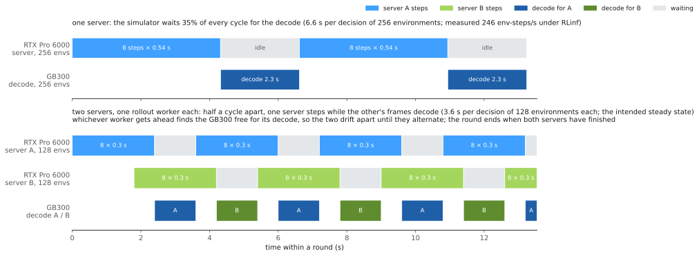
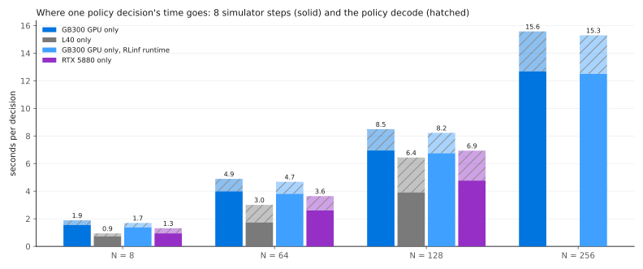
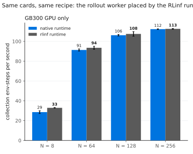
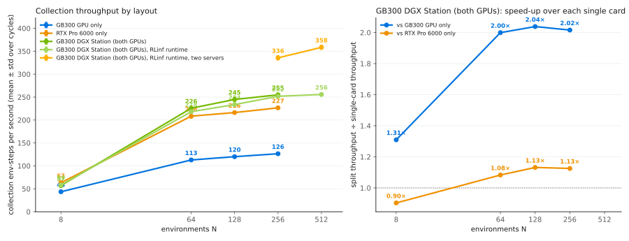
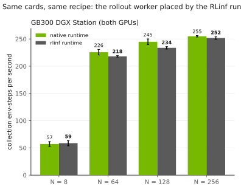
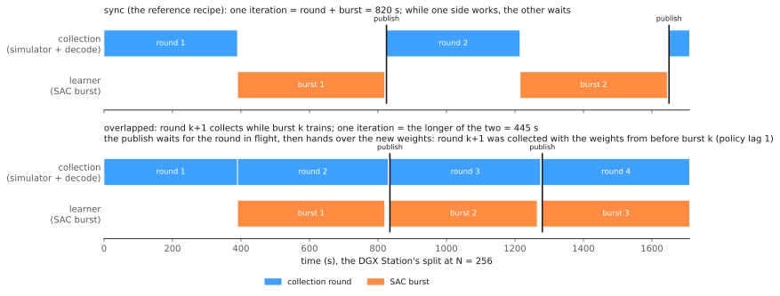

# DGX Station placement: one post-training run across two GPUs

Place a post-training run on a DGX Station's two GPUs and measure how many environment steps per second each placement collects, for DSRL on the Unitree G1 humanoid in IsaacLab-Arena.
The step-by-step guide, including deploying to the station, is [docs/pages/workflows/dgx_example.md](../../docs/pages/workflows/dgx_example.md).

**Status:** exploratory; a placement and throughput toolkit for a two-GPU station, measured on a DGX Station, a GB300-only station, an L40 node and an RTX 5880 workstation.

## Overview

A run has two GPU consumers: the simulator stepping N environments, and the learner process holding the frozen base policy and the SAC steering learner.
They can share one card (the **single** layout) or take one card each, joined over loopback TCP (the **split** layout).
This workflow places a run either way, sweeps N, and reports environment steps per second, where each cycle's time goes, and GPU memory.

A split needs a simulator that runs in its own process behind a server.
`uv run python -m example_workflows.dgx_example.layouts capabilities` renders this table from each simulator's `SimulatorEntry`:

<!-- capabilities:start -->
| Simulator (`env.env_name` segment) | Entry | Simulator process | Layouts | Collection at N > 1 | Decode batch cap | Evaluation |
|---|---|---|---|---|---|---|
| `arena`, `isaac` | `g1_arena` | its own, behind a server | single, split | one batched worker, whole episodes | 16 | dedicated |
| `isaaclab` | `isaaclab` | the learner's | single | one batched worker, whole episodes | none | shared |
| `libero` | `libero` | the learner's | single | one worker per environment | none | fresh_workers |
| `libero_dreamzero` | `libero_dreamzero` | the learner's | single | one worker per environment | none | fresh_workers |
| `libero_pi0` | `libero_pi0` | the learner's | single | one worker per environment | none | fresh_workers |
| `v2d` | `v2d` | its own, behind a server | single, split | one batched worker, whole episodes | none | dedicated |
<!-- capabilities:end -->

G1 Factory (`arena`) is the measured case; Isaac Lab and LIBERO use the same placement code in the single layout and are not measured.
Every layout runs on either rollout runtime (`docs/runtimes.md`).
Native, the default, keeps the rollout worker inside the learner process; RLInf (`RUNTIME=rlinf`) runs it as a Ray actor in its own process.

## Requirements

| | |
|---|---|
| Hardware | a GB300 DGX Station (one GB300 and one RTX Pro 6000 Blackwell with 96 GB) for the station layouts; any card with 48 GB or more runs the single layout up to N = 128 |
| Software | this repository with `uv sync` on a staging machine; the G1 Factory stack pinned in `externals.lock.yaml`, deployed to the station's `/data/src/g1-factory` by `example_workflows/g1_arena_posttraining/scripts/station/stage_and_deploy_station.sh`; Docker, Docker Buildx and the NVIDIA Container Toolkit on the station |
| Data and checkpoints | the GR00T N1.7 G1 checkpoint (`POSTTRAIN_BASE_CKPT`) and the task's LeRobot dataset under `POSTTRAIN_DATA_ROOT/<LMTask>/lerobot`, as for `example_workflows/g1_arena_posttraining/README.md` |
| Weights & Biases | an account and `WANDB_API_KEY` for the throughput sweep |

Run station commands from `/data/src/g1-factory/posttrain` with `PYTHON=$PWD/example_workflows/g1_arena_posttraining/scripts/station/station_python.sh`, because the station's host has no Python.
Build the G1 Factory and learner images once first, as in the guide's install steps.
Every `<uuid>` below is a card's UUID from `nvidia-smi -L`.

## Quickstart

On the staging machine, the CPU check and a placement plan:

```bash
uv run bash example_workflows/dgx_example/smoke.sh        # under two minutes, no GPU; ends with "smoke check passed"
uv run python -m example_workflows.dgx_example.layouts plan --simulator arena --num-envs 64 \
    --simulator-gpu <RTX Pro 6000 uuid> --learner-gpu <GB300 uuid>
```

On the station, the throughput sweep and the training-and-scoring recipe:

```bash
GB300_GPU=<uuid> RTX_GPU=<uuid> bash example_workflows/dgx_example/scripts/layout_sweep.sh
SIMULATOR_GPU=<RTX Pro 6000 uuid> LEARNER_GPU=<GB300 uuid> bash example_workflows/dgx_example/scripts/train_eval.sh DrillLift
```

The sweep runs the three station layouts at every N (`NS`, default `8 64 128 256 512`) with the probe settings of `configs/probe.env`, one W&B run each, named `probe_<layout>_n<N>`.
`train_eval.sh` trains DSRL in the split layout, then scores the frozen policy and the retained checkpoint and prints a `success rate` line for each.
`CKPT_DIR=/data/dsrl_out_g1arena/<run>/checkpoints/<step>` in front skips training.
`ISAAC_RL_POSTTRAINING_DRYRUN=1` in front of either script prints every launch and starts nothing.
Sweep logs go to `$HOME/dgx_example_logs` (`LOG_DIR`); checkpoints and evaluation summaries to `OUT_DIR` (default `/data/dsrl_out_g1arena`).

Both scripts read these knobs from the environment (each script's header lists the rest):

| Knob | Default | Effect |
|---|---|---|
| `RUNTIME` | `native` | `rlinf` runs the rollout worker as a Ray actor on the learner's card, or on `ROLLOUT_GPU=<index>`; runs carry `_rlinf` in their names |
| `SCHEDULE` | `sync` | `overlapped` collects the next round during each training burst (`schedule.kind`, `docs/dsrl.md`); runs carry `_overlapped` |
| `NUM_SERVERS` | 1 | 2 spreads the training environments over two Arena servers on consecutive ports; needs `RUNTIME=rlinf`; runs carry `_2srv` |
| `MAX_UPDATES_PER_BURST` | 20 in the sweep; one update per decision in `train_eval.sh` | SAC updates per burst; the overlapped schedule gains only when a burst takes about as long as a round |
| `LAYOUTS` | the three station layouts | `name:simulator_gpu:learner_gpu ...`, e.g. `gb300_only:<uuid>:<uuid>` on a one-card station |
| `NUM_ENVS`, `TRAIN_ENV_STEPS`, `EVAL_EPISODES` | 64, 100000, 100 | `train_eval.sh` only |
| `EVAL_FREQ`, `EVAL_NUM_ENVS`, `TRAIN_OVERRIDES` | 5000 (config), 1, none | `train_eval.sh` only: evaluation cadence (checkpoints follow it), parallel evaluation episodes, extra training-only Hydra overrides |

At N in the hundreds, set `MAX_UPDATES_PER_BURST` and `EVAL_FREQ` yourself: one SAC update per decision makes a burst of hours, and the 5000-step evaluation cadence falls inside one round.



The throughput numbers are read back from the W&B runs and rendered into this README:

```bash
uv run python -m example_workflows.dgx_example.fetch_wandb example_workflows/dgx_example/results/throughput.json \
    --wandb-path "$WANDB_ENTITY/isaac_rl_posttraining" --util-dir /data/dsrl_out_g1arena/util --log-dir "$HOME/dgx_example_logs"
uv run python -m example_workflows.dgx_example.throughput example_workflows/dgx_example/results/throughput.json --write example_workflows/dgx_example/README.md
uv run python -m example_workflows.dgx_example.figures example_workflows/dgx_example/results/throughput.json --out example_workflows/dgx_example/figures
```

`--block throughput_dgx_station` and `--block throughput_schedules` render the other two results files the same way (`--prefix dgx_station_` for their figures).

## Results

<!-- results:start -->
No validated evaluation results have been published yet.
<!-- results:end -->

This workflow's results are the throughput tables below, in environment steps per second.

### Single-card throughput

<!-- throughput:start -->
Collection throughput in environment steps per second, mean ± std over the run's collection cycles:

| N envs | GB300 GPU only | L40 only | GB300 GPU only, RLinf runtime | RTX 5880 only |
|---|---|---|---|---|
| 8 | 29 ± 1 | 52 ± 3 | 33 ± 0 | 51 ± 3 |
| 64 | 91 ± 1 | 139 ± 2 | 94 ± 2 | 145 ± 8 |
| 128 | 106 ± 1 | 126 ± 2 | 108 ± 2 | 151 ± 5 |
| 256 | 112 ± 0 | — | 113 ± 0 | out of memory |

The same cards and environment count with the rollout worker placed by the RLinf runtime (`runtime=rlinf`: the worker is a Ray actor in its own process) against the native runtime (the worker inside the learner process):

| Placement | N envs | env-steps/s, native | env-steps/s, RLinf | RLinf ÷ native | simulator step (s), native / RLinf | decode (s), native / RLinf | SAC update (s), native / RLinf | peak GPU memory (GiB), native / RLinf |
|---|---|---|---|---|---|---|---|---|
| GB300 GPU only | 8 | 29 ± 1 | 33 ± 0 | 1.15× | 0.19 / 0.17 | 0.34 / 0.32 | 2.65 / 2.13 | 19 / 26 |
| GB300 GPU only | 64 | 91 ± 1 | 94 ± 2 | 1.02× | 0.50 / 0.48 | 0.90 / 0.87 | 2.80 / 2.18 | 28 / 34 |
| GB300 GPU only | 128 | 106 ± 1 | 108 ± 2 | 1.01× | 0.87 / 0.84 | 1.54 / 1.48 | 2.92 / 2.16 | 38 / 43 |
| GB300 GPU only | 256 | 112 ± 0 | 113 ± 0 | 1.00× | 1.58 / 1.56 | 2.90 / 2.79 | 2.87 / 2.22 | 55 / 60 |

Where one collection cycle's time goes (medians over the run), and what the cards hold:

| Layout | N envs | simulator step (s) | policy decode (s) | SAC update (s) | wire (ms/step) | peak GPU memory (GiB) |
|---|---|---|---|---|---|---|
| GB300 GPU only | 8 | 0.19 | 0.34 | 2.65 | 5.0 | 19 |
| GB300 GPU only | 64 | 0.50 | 0.90 | 2.80 | 12.5 | 28 |
| GB300 GPU only | 128 | 0.87 | 1.54 | 2.92 | 18.5 | 38 |
| GB300 GPU only | 256 | 1.58 | 2.90 | 2.87 | 38.0 | 55 |
| L40 only | 8 | 0.09 | 0.21 | 0.89 | — | — |
| L40 only | 64 | 0.22 | 1.27 | 0.89 | — | — |
| L40 only | 128 | 0.49 | 2.53 | 0.95 | — | — |
| GB300 GPU only, RLinf runtime | 8 | 0.17 | 0.32 | 2.13 | 3.0 | 26 |
| GB300 GPU only, RLinf runtime | 64 | 0.48 | 0.87 | 2.18 | 10.0 | 34 |
| GB300 GPU only, RLinf runtime | 128 | 0.84 | 1.48 | 2.16 | 14.5 | 43 |
| GB300 GPU only, RLinf runtime | 256 | 1.56 | 2.79 | 2.22 | 35.0 | 60 |
| RTX 5880 only | 8 | 0.12 | 0.37 | 0.47 | — | — |
| RTX 5880 only | 64 | 0.33 | 1.04 | 0.49 | — | — |
| RTX 5880 only | 128 | 0.60 | 2.17 | 0.49 | — | — |

Recipe: task DrillLift, 1350 environment steps per environment (at least 6400), 8 simulator steps per policy decision, SAC bursts capped at 20 updates of batch 64, frames shrunk to a 256 px shortest edge, the policy decoding all N environments in one forward, no evaluation simulator. Runtime: the runtime layer's episode-synchronous batched worker (every environment plays one episode per iteration; finished environments wait), whole-batch decode. Measured 2026-09-18.
<!-- throughput:end -->

The decode column includes the per-environment actor sampling before the batched GR00T decode (1 to 9 ms per environment, depending on the host).
On the RLinf runtime the GB300 collects within noise of native from N = 64 on, and its own frozen-policy copy costs 5 to 8 GiB more on the card.





### The DGX Station's layouts

The DGX Station's host runs the SAC update about twice as fast as the GB300-only station's, so compare these rows only with each other.

<!-- throughput_dgx_station:start -->
Collection throughput in environment steps per second, mean ± std over the run's collection cycles:

| N envs | GB300 GPU only | RTX Pro 6000 only | GB300 DGX Station (both GPUs) | GB300 DGX Station (both GPUs), RLinf runtime | GB300 DGX Station (both GPUs), RLinf runtime, two servers |
|---|---|---|---|---|---|
| 8 | 44 ± 2 | 63 ± 2 | 57 ± 4 | 59 ± 5 | — |
| 64 | 113 ± 1 | 208 ± 4 | 226 ± 5 | 218 ± 1 | — |
| 128 | 120 ± 0 | 216 ± 1 | 245 ± 5 | 234 ± 2 | — |
| 256 | 126 ± 1 | 227 ± 2 | 255 ± 1 | 252 ± 2 | 336 ± 5 |
| 512 | — | — | — | 256 ± 1 | 358 ± 5 |

**GB300 DGX Station (both GPUs)** over each single card:

| N envs | vs GB300 GPU only | vs RTX Pro 6000 only |
|---|---|---|
| 8 | 1.31× | 0.90× |
| 64 | 2.00× | 1.08× |
| 128 | 2.04× | 1.13× |
| 256 | 2.02× | 1.13× |

The same cards and environment count with the rollout worker placed by the RLinf runtime (`runtime=rlinf`: the worker is a Ray actor in its own process) against the native runtime (the worker inside the learner process):

| Placement | N envs | env-steps/s, native | env-steps/s, RLinf | RLinf ÷ native | simulator step (s), native / RLinf | decode (s), native / RLinf | SAC update (s), native / RLinf | peak GPU memory (GiB), native / RLinf |
|---|---|---|---|---|---|---|---|---|
| GB300 DGX Station (both GPUs) | 8 | 57 ± 4 | 59 ± 5 | 1.03× | 0.09 / 0.08 | 0.24 / 0.27 | 1.25 / 1.19 | 9 simulator + 8 learner / 9 simulator + 16 learner |
| GB300 DGX Station (both GPUs) | 64 | 226 ± 5 | 218 ± 1 | 0.97× | 0.16 / 0.16 | 0.65 / 0.70 | 1.25 / 1.19 | 14 simulator + 12 learner / 14 simulator + 19 learner |
| GB300 DGX Station (both GPUs) | 128 | 245 ± 5 | 234 ± 2 | 0.95× | 0.30 / 0.30 | 1.16 / 1.27 | 1.30 / 1.24 | 19 simulator + 16 learner / 19 simulator + 23 learner |
| GB300 DGX Station (both GPUs) | 256 | 255 ± 1 | 252 ± 2 | 0.99× | 0.54 / 0.54 | 2.26 / 2.49 | 1.28 / 1.27 | 27 simulator + 24 learner / 28 simulator + 31 learner |

The same cards, runtime and schedule with the training environments spread over several simulator servers, one batched rollout worker each, so one server steps while another's frames decode, against one server hosting them all:

| Placement | N envs | servers | env-steps/s, one server | env-steps/s, several | several ÷ one | env-steps/s per iteration, one / several | simulator step (s), one / several | decode (s), one / several | peak GPU memory (GiB), one / several |
|---|---|---|---|---|---|---|---|---|---|
| GB300 DGX Station (both GPUs), RLinf runtime | 256 | 2 | 252 ± 2 | 336 ± 5 | 1.33× | — / 309 | 0.54 / 0.47 | 2.49 / 1.34 | 28 simulator + 31 learner / 37 simulator + 38 learner |
| GB300 DGX Station (both GPUs), RLinf runtime | 512 | 2 | 256 ± 1 | 358 ± 5 | 1.40× | 247 / 342 | 1.04 / 0.85 | 4.82 / 2.76 | 48 simulator + 46 learner / 54 simulator + 54 learner |

Where one collection cycle's time goes (medians over the run), and what the cards hold:

| Layout | N envs | simulator step (s) | policy decode (s) | SAC update (s) | wire (ms/step) | peak GPU memory (GiB) |
|---|---|---|---|---|---|---|
| GB300 GPU only | 8 | 0.12 | 0.23 | 1.20 | 1.0 | 19 |
| GB300 GPU only | 64 | 0.41 | 0.64 | 1.25 | 2.0 | 27 |
| GB300 GPU only | 128 | 0.78 | 1.19 | 1.29 | 4.0 | 36 |
| GB300 GPU only | 256 | 1.46 | 2.26 | 1.28 | 9.0 | 53 |
| RTX Pro 6000 only | 8 | 0.09 | 0.22 | 1.17 | 1.0 | 17 |
| RTX Pro 6000 only | 64 | 0.16 | 0.73 | 1.19 | 2.0 | 25 |
| RTX Pro 6000 only | 128 | 0.30 | 1.50 | 1.21 | 4.0 | 35 |
| RTX Pro 6000 only | 256 | 0.54 | 3.07 | 1.21 | 8.5 | 52 |
| GB300 DGX Station (both GPUs) | 8 | 0.09 | 0.24 | 1.25 | 1.0 | 9 simulator + 8 learner |
| GB300 DGX Station (both GPUs) | 64 | 0.16 | 0.65 | 1.25 | 2.0 | 14 simulator + 12 learner |
| GB300 DGX Station (both GPUs) | 128 | 0.30 | 1.16 | 1.30 | 4.5 | 19 simulator + 16 learner |
| GB300 DGX Station (both GPUs) | 256 | 0.54 | 2.26 | 1.28 | 9.5 | 27 simulator + 24 learner |
| GB300 DGX Station (both GPUs), RLinf runtime | 8 | 0.08 | 0.27 | 1.19 | 1.0 | 9 simulator + 16 learner |
| GB300 DGX Station (both GPUs), RLinf runtime | 64 | 0.16 | 0.70 | 1.19 | 2.0 | 14 simulator + 19 learner |
| GB300 DGX Station (both GPUs), RLinf runtime | 128 | 0.30 | 1.27 | 1.24 | 4.0 | 19 simulator + 23 learner |
| GB300 DGX Station (both GPUs), RLinf runtime | 256 | 0.54 | 2.49 | 1.27 | 8.5 | 28 simulator + 31 learner |
| GB300 DGX Station (both GPUs), RLinf runtime | 512 | 1.04 | 4.82 | 1.27 | 19.5 | 48 simulator + 46 learner |
| GB300 DGX Station (both GPUs), RLinf runtime, two servers | 256 | 0.47 | 1.34 | 1.23 | 4.5 | 37 simulator + 38 learner |
| GB300 DGX Station (both GPUs), RLinf runtime, two servers | 512 | 0.85 | 2.76 | 1.27 | 8.5 | 54 simulator + 54 learner |

Recipe: task DrillLift, 1350 environment steps per environment (at least 6400), 8 simulator steps per policy decision, SAC bursts capped at 20 updates of batch 64, frames shrunk to a 256 px shortest edge, the policy decoding all N environments in one forward, no evaluation simulator. Runtime: the runtime layer's episode-synchronous batched worker on the DGX Station (GB300 + RTX Pro 6000), whole-batch decode; the native rows and the split on the RLinf runtime. Measured 2026-09-18.
<!-- throughput_dgx_station:end -->

A single card flattens above N = 64, because it serves both the simulator's rendering and the policy's decode.
Both GPUs together collect twice what the GB300 alone does at N = 256, and 13 % more than the RTX Pro 6000 alone.
The RTX Pro 6000 steps the simulator faster and the GB300 decodes GR00T faster, so the split puts the simulator on the RTX Pro 6000 and the policy and learner on the GB300.
On one card the stack needs 52 to 53 GiB at N = 256, which rules out 48 GB cards from there on.
Loopback transport costs about one percent of a cycle.

Two Arena servers raise the collection rate 1.33× at N = 256 and 1.40× at 512, because one server steps while the other's frames decode.
The cost is a second Isaac Sim process on the RTX Pro 6000 and a second frozen-policy copy on the GB300.





### The overlapped schedule on the DGX Station

The split at N = 256, with the SAC burst sized to the collection round, on the sync and the overlapped schedule (`results/throughput_schedules.json`).
The compared number is the rate over whole iterations (round, burst and publish), not the collection rate.



<!-- throughput_schedules:start -->
Collection throughput in environment steps per second, mean ± std over the run's collection cycles:

| N envs | GB300 DGX Station (both GPUs) | GB300 DGX Station (both GPUs), overlapped schedule | GB300 DGX Station (both GPUs), RLinf runtime | GB300 DGX Station (both GPUs), RLinf runtime, overlapped schedule | GB300 DGX Station (both GPUs), RLinf runtime, overlapped schedule, two servers |
|---|---|---|---|---|---|
| 256 | 259 ± 5 | 225 ± 1 | 246 ± 0 | 230 ± 2 | 332 ± 10 |


The same cards and environment count with the rollout worker placed by the RLinf runtime (`runtime=rlinf`: the worker is a Ray actor in its own process) against the native runtime (the worker inside the learner process):

| Placement | N envs | env-steps/s, native | env-steps/s, RLinf | RLinf ÷ native | simulator step (s), native / RLinf | decode (s), native / RLinf | SAC update (s), native / RLinf | peak GPU memory (GiB), native / RLinf |
|---|---|---|---|---|---|---|---|---|
| GB300 DGX Station (both GPUs) | 256 | 259 ± 5 | 246 ± 0 | 0.95× | 0.54 / 0.54 | 2.29 / 2.48 | 1.33 / 1.29 | 27 simulator + 24 learner / 27 simulator + 31 learner |

The same cards and environment count with the learner on the overlapped schedule (`schedule.kind=overlapped`: the next round collects during the burst) against the sync schedule, in environment steps per second over whole iterations (round, burst and publish). Under the overlapped schedule the round wall is the round's own end (stamped where the round ran), so it is shorter than the iteration whenever the burst outlasts it; the per-decision decode is the round's own cost:

| Placement | N envs | env-steps/s per iteration, sync | env-steps/s per iteration, overlapped | overlapped ÷ sync | round / burst / publish (s), sync | round / burst / publish (s), overlapped | decode (s), sync / overlapped | SAC update (s), sync / overlapped |
|---|---|---|---|---|---|---|---|---|
| GB300 DGX Station (both GPUs) | 256 | 123 ± 1 | 222 ± 16 | 1.81× | 389 / 429 / 0 | 452 / 492 / 0 | 2.29 / 3.13 | 1.33 / 1.27 |
| GB300 DGX Station (both GPUs), RLinf runtime | 256 | 121 ± 0 | 234 ± 5 | 1.93× | 406 / 419 / 0 | 445 / 424 / 18 | 2.48 / 3.13 | 1.29 / 1.29 |

The same cards, runtime and schedule with the training environments spread over several simulator servers, one batched rollout worker each, so one server steps while another's frames decode, against one server hosting them all:

| Placement | N envs | servers | env-steps/s, one server | env-steps/s, several | several ÷ one | env-steps/s per iteration, one / several | simulator step (s), one / several | decode (s), one / several | peak GPU memory (GiB), one / several |
|---|---|---|---|---|---|---|---|---|---|
| GB300 DGX Station (both GPUs), RLinf runtime, overlapped schedule | 256 | 2 | 230 ± 2 | 332 ± 10 | 1.44× | 234 / 249 | 0.55 / 0.45 | 3.13 / 1.81 | 28 simulator + 31 learner / 38 simulator + 39 learner |

Where one collection cycle's time goes (medians over the run), and what the cards hold:

| Layout | N envs | simulator step (s) | policy decode (s) | SAC update (s) | wire (ms/step) | peak GPU memory (GiB) |
|---|---|---|---|---|---|---|
| GB300 DGX Station (both GPUs) | 256 | 0.54 | 2.29 | 1.33 | 8.5 | 27 simulator + 24 learner |
| GB300 DGX Station (both GPUs), overlapped schedule | 256 | 0.55 | 3.13 | 1.27 | 8.5 | 28 simulator + 24 learner |
| GB300 DGX Station (both GPUs), RLinf runtime | 256 | 0.54 | 2.48 | 1.29 | 8.5 | 27 simulator + 31 learner |
| GB300 DGX Station (both GPUs), RLinf runtime, overlapped schedule | 256 | 0.55 | 3.13 | 1.29 | 8.5 | 28 simulator + 31 learner |
| GB300 DGX Station (both GPUs), RLinf runtime, overlapped schedule, two servers | 256 | 0.45 | 1.81 | 1.26 | 5.0 | 38 simulator + 39 learner |

Recipe: task DrillLift, 1350 environment steps per environment (at least 6400), 8 simulator steps per policy decision, SAC bursts capped at 310 updates of batch 64, frames shrunk to a 256 px shortest edge, the policy decoding all N environments in one forward, no evaluation simulator. Runtime: the runtime layer's episode-synchronous batched worker on the DGX Station (GB300 + RTX Pro 6000): the split at N = 256 with the SAC burst sized to the collection round, on the sync and the overlapped schedule, with the rollout worker on the native and on the RLinf runtime; the overlapped rows were measured on 2026-09-20, where a round's wall is its own end, stamped where the round ran. Measured 2026-09-19 (sync rows) and 2026-09-20 (overlapped rows).
<!-- throughput_schedules:end -->

On the sync schedule the round and the burst run back to back, so the run advances at 123 steps per second while collection runs at 259.
The overlapped schedule hides the burst behind the next round: 1.81× the sync rate on the native runtime and 1.93× on RLInf.
It stops short of 2× because the decode and the SAC updates share the GB300.
Two servers add little under the overlapped schedule (234 to 249 steps per second): once collection outruns training, the learner's pace caps the run.

## Method

1. **Placement.** `layouts.py` derives single or split from `isaac_rl_posttraining/envs/simulator_entry.py` and refuses a split the simulator cannot run before anything launches.
   The launch goes through the station scripts in `example_workflows/g1_arena_posttraining/scripts/station/`, which pin each container to a card.
2. **Rollout.** DSRL (`docs/dsrl.md`) trains SAC to steer the flow-matching noise of the frozen GR00T N1.7 policy.
   One decision drives eight simulator steps for all N environments in one Isaac Sim instance, with frames shrunk to a 256 px shortest edge.
3. **Measurement.** The probe (`configs/probe.env`) decodes all N environments in one forward, collects three full-length epochs, caps each SAC burst at 20 updates and runs no evaluation simulator, so collection rates compare across N and cards.
   `fetch_wandb.py` reads the trainer's `system/` and `train/collector/` metrics.
4. **Evaluation.** As in `example_workflows/g1_arena_posttraining/scripts/eval.sh`: 100 unseeded episodes each for the frozen policy and the retained checkpoint, with the steering actor sampled.

## Files

| Path | Purpose |
|---|---|
| `smoke.sh` | the setup check CI runs |
| `layouts.py` | placement derived from the simulator entry; the capability table; the `plan` command |
| `throughput.py` | `results/throughput.json`: schema, checks and the README tables |
| `fetch_wandb.py` | fills `results/throughput.json` from the W&B runs, the launcher's telemetry and the logs |
| `figures.py`, `schematics.py` | the figures and the two schematics |
| `readme_blocks.py` | the generated README blocks between their markers |
| `scripts/layout_sweep.sh` | the layout sweep on the station |
| `scripts/train_eval.sh` | DSRL in the split layout, then base and checkpoint scored |
| `scripts/station.sh` | finds the simulator's station launchers and maps `SCHEDULE` to `schedule.kind` |
| `configs/probe.env` | the probe settings every run shares |
| `results/results.json` | no success rows: this workflow measures throughput |
| `results/throughput*.json` | the single-card, DGX Station and schedule throughput numbers with their run ids and recipe |
| `figures/` | the rendered figures |
| `externals.lock.yaml` | the pinned simulator stack |
| `tests/` | placement, results and dry-run contracts, and the recipes' pinned configs (`golden_config.json`); no hardware |
