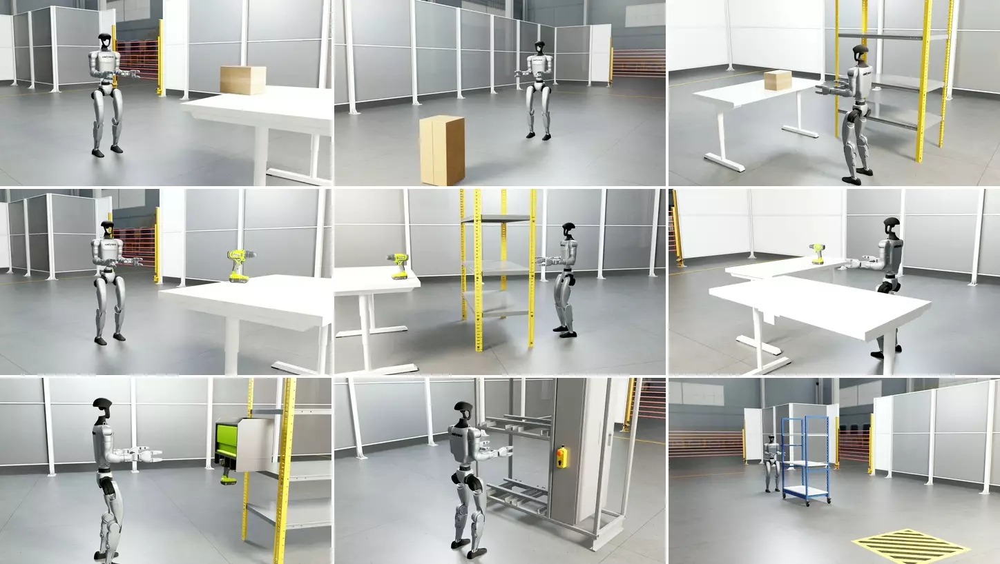

# G1 Factory post-training

Raise the success rate of a frozen GR00T N1.7 humanoid policy on nine IsaacLab-Arena tasks with online reinforcement learning, and measure the change against the frozen policy under one evaluator.
The full step-by-step guide is [docs/pages/workflows/g1_arena.md](../../docs/pages/workflows/g1_arena.md).

**Status:** validated: DSRL and full PPO fine-tuning on all nine G1 Factory tasks from the published GR00T N1.7 checkpoint (2026-10-12); RFS, SAC-edit and PPO steering share the pipeline



Successful episodes of GR00T N1.7 after full PPO fine-tuning, in real time; each holds its last frame until the longest finishes.
Rows, left to right: `LMBoxLift`, `LMBoxLiftFloor`, `LMBoxTableToShelfPnP`; `LMDrillLift`, `LMDrillLiftObs`, `LMDrillPnP`; `LMPickDrillFromHolder`, `LMPushButton`, `LMPushShelfForward`.

## Overview

The base policy is GR00T N1.7 fine-tuned on Unitree G1 teleoperation demonstrations ([`nvidia/G1-Factory-Benchmark`](https://huggingface.co/datasets/nvidia/G1-Factory-Benchmark)).
It maps the head camera, the joint state and a task instruction to chunks of 35-dimensional whole-body actions; a separate balance controller moves the legs.
The workflow trains a small steering policy (DSRL) or GR00T's action head itself (full PPO fine-tuning) on one task, then scores saved checkpoints and the frozen policy on the same held-out episodes.
RFS, SAC-edit and PPO steering share the pipeline, and offline SFT and IQL (untested) train GR00T N1.7 from demonstrations.
The base checkpoint and a trained PushButton steering policy are on Hugging Face.

## Requirements

| | |
|---|---|
| Hardware | Linux x86_64 with one NVIDIA RTX-class GPU with 48 GB of memory per training run or evaluation; about 120 GB of host memory per run |
| Software | this repository (`uv sync`); [G1 Factory](https://github.com/NVlabs/G1-Factory), installed with its submodules by following its own instructions (the nine `LM*` tasks, with IsaacLab-Arena and Isaac-GR00T as submodules), and its scene assets, [`nvidia/G1-Factory`](https://huggingface.co/datasets/nvidia/G1-Factory), in `$G1_FACTORY/datasets/assets` |
| Checkpoint | `nvidia/G1-Factory-GR00T-1.7` on Hugging Face (about 6.5 GB); DSRL, PPO and evaluation need only the checkpoint; offline SFT/IQL training and dataset replay read one LeRobot dataset per task at `$POSTTRAIN_DATA_ROOT/<LMTask>/lerobot`, from [`nvidia/G1-Factory-Benchmark`](https://huggingface.co/datasets/nvidia/G1-Factory-Benchmark) |
| Access | a Hugging Face token with access to the gated `nvidia/Cosmos-Reason2-2B` backbone; Weights & Biases is optional (`WANDB_API_KEY`) |

Install everything as in steps 1-8 of the [guide](../../docs/pages/workflows/g1_arena.md#installation), then, in every shell, from the repository root:

```bash
export G1_FACTORY=$(realpath ../g1-factory)
export ISAACLAB_ARENA_PATH=$G1_FACTORY/submodules/IsaacLab-Arena
export PYTHONPATH=$G1_FACTORY                     # replaces any earlier value
export POSTTRAIN_BASE_CKPT=$PWD/checkpoints/G1-Factory-GR00T-1.7
export POSTTRAIN_DATA_ROOT=$PWD/datasets
```

## Quickstart

From the repository root:

```bash
uv run bash example_workflows/g1_arena_posttraining/smoke.sh                                   # no GPU, under two minutes; ends with `smoke check passed`
uv run bash example_workflows/g1_arena_posttraining/scripts/reproduce_results.sh dsrl DrillLift 0  # one 80k-step DSRL run
uv run bash example_workflows/g1_arena_posttraining/scripts/eval.sh DrillLift base 100         # the downloaded GR00T checkpoint alone
uv run bash example_workflows/g1_arena_posttraining/scripts/eval.sh DrillLift policy 100 \
  ~/isaac_rl_outputs/<run name>_<timestamp>/checkpoints/final                                  # GR00T steered by your trained checkpoint
```

Checkpoints land in `$ISAAC_RL_POSTTRAINING_OUTPUT_DIR/<run name>_<timestamp>/checkpoints/` (default `~/isaac_rl_outputs`, printed at start as `plan.checkpoint_dir=`): `final` at the end, plus one folder about every 5,000 environment steps.
Only PushButton has a published steering checkpoint; train any other task before scoring its `policy` ([Evaluation](../../docs/pages/workflows/g1_arena.md#evaluation)).
An evaluation ends with a line carrying `SR=<percent>`.
`ALGO=rfs|sac_edit|dsrl_ppo|sft|iql` in front of `train.sh` selects another algorithm; `NUM_ENVS` and `NUM_SERVERS` run several scenes per simulator and several simulators.
The same runs also start from Isaac Lab's command line (`uv run isaaclab train --rl_library isaac_rlpt --task LMDrillPnP --algorithm ppo --model_path nvidia/G1-Factory-GR00T-1.7`) in this folder's own environment ([Run from Isaac Lab's command line](../../docs/pages/workflows/g1_arena.md#run-from-isaac-labs-command-line)).

## Results

### G1 Factory base policy

The base checkpoint `nvidia/G1-Factory-GR00T-1.7` in G1 Factory's own evaluation (100 episodes per task, CPU physics, 20-second episodes), as reported by [G1 Factory](https://github.com/NVlabs/G1-Factory):

| Task | Success rate |
|---|---|
| BoxLift | 98% |
| BoxLiftFloor | 96% |
| BoxTableToShelfPnP | 77% |
| DrillLift | 66% |
| DrillLiftObs | 75% |
| DrillPnP | 69% |
| PickDrillFromHolder | 44% |
| PushButton | 42% |
| PushShelfForward | 58% |
| Overall | 69.4% |

### DSRL and PPO

The DSRL and PPO tables come from this repository's evaluators, each scoring its own method and the base checkpoint.
These use GPU physics (the physics used for training), 20-second episodes and 50 held-out episodes per task.
G1 Factory's evaluation uses CPU physics and 100 episodes, so these base scores are not directly comparable with the G1 Factory table.
Compare each method only with the base in its own table.

#### DSRL

| Task | Base | Peak | Final |
|---|---|---|---|
| BoxLift | 96% | 98% | 100% |
| BoxLiftFloor | 84% | 96% | 92% |
| BoxTableToShelfPnP | 74% | 80% | 56% |
| DrillLift | 62% | 90% | 70% |
| DrillLiftObs | 82% | 62% | 60% |
| DrillPnP | 54% | 86% | 74% |
| PickDrillFromHolder | 30% | 40% | 20% |
| PushButton | 74% | 66% | 64% |
| PushShelfForward | 0% | 8% | 6% |
| Overall | 61.8% | 69.6% | 60.2% |

#### PPO

| Task | Base | Peak | Final |
|---|---|---|---|
| BoxLift | 94% | 98% | 92% |
| BoxLiftFloor | 72% | 96% | 90% |
| BoxTableToShelfPnP | 66% | 76% | 74% |
| DrillLift | 66% | 84% | 84% |
| DrillLiftObs | 58% | 88% | 70% |
| DrillPnP | 54% | 84% | 82% |
| PickDrillFromHolder | 18% | 52% | 36% |
| PushButton | 48% | 90% | 78% |
| PushShelfForward | 0% | 20% | 10% |
| Overall | 52.9% | 76.4% | 68.4% |

In both tables, Base is the frozen base checkpoint scored by that method's evaluator.
Peak is the run's checkpoint with the best in-training evaluation (ties go to the earliest), re-scored on the held-out episodes.
Final is the run's last checkpoint, re-scored the same way.
Each row is one of three training seeds: the seed with the highest Peak, or on a tie the one with the higher Final.
Both methods execute all 40 actions of each policy chunk.

The released PushButton steering policy, scored by this workflow against the base checkpoint:

<!-- results:start -->
| Task | Method | Base | Peak | Final | Note |
|---|---|---|---|---|---|
| PushButton | DSRL | 61.3% n=300 | 82.0% n=300 | — | released checkpoint `nvidia/Isaac-RLPT-GR00T-1.7-G1-Factory-PushButton-DSRL`, 72,488 of 80,000 steps |

Success rates; n is the episode count. Evaluator: G1 Factory served by `simulators/g1_arena/env_server.py`, one scene at a time, GPU physics, native camera frame, stochastic steering actor, success when the task's success term fires within 1000 simulator steps (20 s, G1 Factory's episode length). The base checkpoint `nvidia/G1-Factory-GR00T-1.7` and the released steering checkpoint are scored on the same 300 held-out episodes (seeds 5050–5199 and 6000–6149). Peak is the checkpoint chosen by its in-training evaluation. This differs from G1 Factory's evaluation, which reports 42% for the base checkpoint on PushButton. Measured 2026-10-21.
<!-- results:end -->

`scripts/reproduce_results.sh` holds the training and scoring commands: `dsrl` and `ppo` train, `base`, `rescore` and `rescore_ppo` score.
`uv run python -m example_workflows._common.results_table example_workflows/g1_arena_posttraining/results/results.json --write example_workflows/g1_arena_posttraining/README.md` renders the table.

## Method

Each run has two kinds of process connected over TCP: the simulator (IsaacLab-Arena under its own Python, served by `simulators/g1_arena/env_server.py`) and the learner (`scripts/train.py` with the GR00T package).
Training uses one simulator for collection and one for evaluation, because a server accepts a single client.
`NUM_ENVS>1` clones the scene inside the training simulator, and `NUM_SERVERS` splits the scenes over several training simulators.
The default recipe (`simulator=g1_arena`, `base_model=gr00t`, `algorithm=dsrl_sac`) has the steering actor pick the noise that seeds GR00T's flow sampler, bounded to [-1, 1], one latent per flow step (`training.chunk_size=40`), and executes 8 actions of each decoded chunk per decision.
SAC learns from a sparse reward of 0 on success and -1 otherwise.
`scripts/reproduce_results.sh dsrl` changes four settings: noise bound 2.0, the actor initialized at the frozen policy's own noise (zero mean, log standard deviation -0.46), a reward of 1 on success and 0 otherwise, and a fixed entropy coefficient of 0.05 over 80,000 steps.
Scoring follows `example_workflows/_common/EVALUATION.md`.
Full PPO fine-tuning (`finetune_ppo.sh`, `algorithm=ppo`) trains the action head through `isaac_rl_posttraining/policies/gr00t/flow_sde_n17.py`; `scripts/reproduce_results.sh ppo` runs 100 iterations at the launcher's defaults (actor learning rate 1e-5, eight scenes per simulator).
`docs/ppo.md`, `docs/iql.md`, `docs/sft.md` and `docs/runtimes.md` describe the other algorithms and runtimes.

## Files

| Path | Purpose |
|---|---|
| `smoke.sh` | the setup check CI runs: every launcher's dry run (each ending in the library's), the Python recipe's dry run, the golden-config check and the results-table check |
| `scripts/train.sh` | boots the simulators and the learner for one task; `train.sh TASK [Hydra overrides]`; its header lists every knob |
| `scripts/eval.sh` | scores the frozen policy (`eval.sh TASK base N`) or a checkpoint (`eval.sh TASK policy N CKPT_DIR`); `eval.sh TASK replay N` replays a demonstration |
| `scripts/reproduce_results.sh` | the exact training and scoring protocol: `dsrl TASK [SEED]`, `ppo TASK [SEED]`, `base TASK`, `rescore TASK CKPT_DIR`, `rescore_ppo TASK ITER_DIR` |
| `scripts/repro_sep2026.sh` | the older 40,000-step protocol: `train TASK [SEED]`, `base TASK`, `rescore TASK CKPT_DIR` |
| `scripts/zoo_recipes.sh` | RFS, its variants and SAC-edit under the same protocol: `zoo_recipes.sh rfs|rfs_pc|rfs_nb2|sac_edit TASK [SEED]` |
| `scripts/train_ppo.sh` | `train.sh` with PPO steering selected |
| `scripts/finetune_ppo.sh` | `train.sh` with full PPO fine-tuning of GR00T's action head; also scores its checkpoints (`placement.learner.ranks=0 ppo.eval_only=true`) |
| `scripts/task_prompts.sh` | each task's language instruction |
| `scripts/station/` | the container launchers of a multi-GPU workstation (`station_train.sh` on the host, `run_container_train.sh` inside the container); `example_workflows/dgx_example/` drives them |
| `run.py` | the DSRL recipe of `train.sh` from Python (`launch(DSRL(...), ...)`) |
| `scripts/preflight_batched.sh`, `scripts/smoke_batched.py`, `scripts/smoke_batched_decode.py` | checks of a batched (`NUM_ENVS>1`) setup; the first without a simulator, the others against a running batched server or the checkpoint |
| `scripts/replay_dataset.py`, `scripts/capture_reset_replay.py` | diagnostics: replay a demonstration through the simulator, capture two seeded resets |
| `finetune_configs/` | the GR00T modality configs and the recipe that produced the base checkpoint |
| `results/results.json` | every reported number with its provenance |
| `tests/` | what runs without hardware: the dry run of every launcher, recipe and task, the resolved config of every recipe against `tests/golden_config.json` (`golden_cases.py` lists the recipes), the reset-capture client, the results table |
