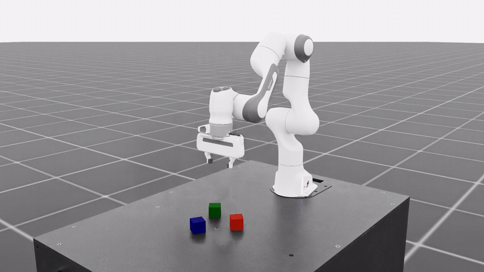

# Isaac Lab: PPO fine-tuning and steering of a GR00T checkpoint

Post-train a GR00T policy on an Isaac Lab task from Isaac Lab's own `train` / `play` commands (`uv run isaaclab train --rl_library isaac_rlpt`).
Steer the frozen policy with DSRL, RFS or SAC-edit, or fine-tune its action head with PPO.
The full step-by-step guide is the [workflow page](../../docs/pages/workflows/isaaclab_gr00t.md).

**Status:** exploratory (the smoke check passes; each number below is an in-training evaluation of a single run, not a re-score of the retained checkpoint)



A successful episode of `Isaac-Stack-Cube-Franka-IK-Rel-Visuomotor-v0` in real time, from GR00T N1.5 after 400 iterations of PPO fine-tuning of its action head.

## Overview

The starting point is GR00T N1.5 fine-tuned on Franka cube-stacking demonstrations.
*Steering* keeps the policy frozen and trains a small learner around it: DSRL chooses the noise the policy denoises from, RFS adds a bounded residual to the decoded actions, and SAC-edit edits the proposed chunk directly.
*PPO fine-tuning* makes one denoising step stochastic so a chunk has a likelihood, and updates the action head while the vision-language backbone stays frozen.
Base and trained policies are scored by the same evaluator; success means the episode ended in the task's success termination.

## Requirements

- One 48 GB GPU for steering or single-GPU PPO; one 8-GPU node for distributed PPO.
- Linux x86-64 (Ubuntu 22.04 or newer), Git and [uv](https://docs.astral.sh/uv/getting-started/installation/).
- This folder's own uv environment: Isaac Sim 6.2, Isaac Lab (`release/3.0.0`, editable), GR00T N1.5 and this repository, at the pins in `externals.lock.yaml` and `uv.lock` (about 30 GB with uv's cache; the first `uv sync` takes 15 to 30 minutes).
  The 3.0.0-beta2 container with `scripts/setup_env.sh` is the alternative.
- The public checkpoint [`RLinf/RLinf-Gr00t-SFT-Stack-cube`](https://huggingface.co/RLinf/RLinf-Gr00t-SFT-Stack-cube), about 8 GB.
- Optional: Weights & Biases (`--wandb_offline` logs locally).

Setup, once:

```bash
git clone https://github.com/nvidia-isaac/isaac-rlpt.git
cd isaac-rlpt/example_workflows/isaaclab_gr00t_posttraining
bash scripts/fetch_externals.sh    # Isaac Lab, GR00T N1.5 and pytorch3d's rotation code, at their pins, into .externals/
uv sync                            # Isaac Sim 6.2, Isaac Lab, GR00T N1.5 and this repository, into .venv/
export OMNI_KIT_ACCEPT_EULA=yes    # accepts the Isaac Sim license; without it Isaac Sim asks at first launch
export CKPT=$PWD/checkpoints/RLinf-Gr00t-SFT-Stack-cube   # any directory with 8 GB free
uv run hf download --repo-type model RLinf/RLinf-Gr00t-SFT-Stack-cube --local-dir "$CKPT"
```

The workflow has its own environment because GR00T N1.5 needs `transformers` 4.51.3 and Isaac Sim 6.2 needs torch 2.11, which the root environment cannot hold.
Isaac Lab is pinned to a commit of its `release/3.0.0` branch until that release is on PyPI.
Run `fetch_externals.sh`, then `uv sync`, again after `externals.lock.yaml` changes.

In the Isaac Lab container (the [workflow page](../../docs/pages/workflows/isaaclab_gr00t.md) has the `docker run` command), run `scripts/setup_env.sh` and source `~/isaac_rlpt/isaac_rlpt_env.sh`; every command below is then the same.
For multi-GPU PPO there, also run `scripts/setup_runtime.sh`.

## Quickstart

CPU smoke check, from this folder with the environment above:

```bash
uv run bash smoke.sh   # ends with "smoke check passed"
```

Train and evaluate from this folder with the environment above:

```bash
TASK=Isaac-Stack-Cube-Franka-IK-Rel-Visuomotor-v0

# DSRL on 8 scenes; --algorithm rfs, rfs_pc or sac_edit selects another steering method
uv run isaaclab train --rl_library isaac_rlpt --task $TASK --model_path $CKPT --algorithm dsrl_sac \
    --num_steps 40000 --eval_freq 10000 --eval_episodes 32 --num_envs 8 --headless --run_name stack_dsrl

# PPO on one GPU; for 8 GPUs, uv run --extra rlinf isaaclab train ... --runtime rlinf --learner_gpus 4 --rollout_gpus 4 --num_envs 64
uv run isaaclab train --rl_library isaac_rlpt --task $TASK --model_path $CKPT --algorithm ppo --num_envs 16 --run_name stack_ppo

# Score the frozen policy, the DSRL actor and the latest PPO snapshot
uv run isaaclab play --rl_library isaac_rlpt --task $TASK --model_path $CKPT --eval_episodes 50 --headless
STEER_CKPT=$(ls -d logs/isaac_rlpt/stack_dsrl_*/checkpoints/final | tail -n 1)
uv run isaaclab play --rl_library isaac_rlpt --task $TASK --model_path $CKPT --algorithm dsrl_sac \
    --checkpoint "$STEER_CKPT" --eval_episodes 50 --headless
PPO_CKPT=$(ls -d logs/isaac_rlpt/stack_ppo_*/checkpoints/iteration_* | sort -V | tail -n 1)
uv run isaaclab play --rl_library isaac_rlpt --task $TASK --model_path $CKPT --algorithm ppo \
    --checkpoint "$PPO_CKPT" --num_envs 16 --eval_episodes 64
```

Each evaluation prints an `[EVAL] Success Rate` line; runs land in `logs/isaac_rlpt/<run_name>_<timestamp>/`.
`--list_tasks` prints the supported tasks and `--dry_run` prints the composed plan without launching.
`--algorithm dsrl_ppo` trains the DSRL steering actor with PPO.
The single-GPU PPO run also starts from Python: `PYTHONPATH=../..:$PYTHONPATH uv run python -m example_workflows.isaaclab_gr00t_posttraining.run $CKPT` (`run.py`; `--dry-run` prints the plan).
Every flag is in [cli_reference.md](../../docs/pages/cli_reference.md).

## Results

Each row is one run at its own budget, and the budgets are not equal.
PPO ran 400 iterations on 2 learner and 2 rollout GPUs with 32 scenes (about 22 hours), evaluating 64 seeded episodes every 10 iterations.
DSRL, RFS and SAC-edit each ran 40,000 environment steps on one GPU with one scene (about 6 hours), evaluating 50 episodes every 5,000 steps.

<!-- results:start -->
| Task | Method | Base | Peak | Final | Note |
|---|---|---|---|---|---|
| stack cube | DSRL | 67.0% n=200 | 70.0% n=50 | 52.0% n=50 |  |
| stack cube | RFS | 67.0% n=200 | 62.0% n=50 | 44.0% n=50 |  |
| stack cube | SAC-edit | 67.0% n=200 | 56.0% n=50 | 44.0% n=50 |  |
| stack cube | PPO | 67.0% n=200 | 85.9% n=64 | 85.9% n=64 | the same checkpoint scored 35/64 under this evaluator before training |

Success rates; n is the episode count. Evaluator: Isaac Lab stack-cube under the frozen policy, stochastic steering actor, success when the stacking condition holds at episode end. The frozen policy was scored twice in one job with no gradient step between the draws and the two are pooled. Peak is the best evaluation of a run and final is its last; each row is one training run. Measured 2026-09-21.
<!-- results:end -->

A validated entry needs the retained checkpoint re-scored over at least 50 episodes next to the base in the same session.
Regenerate the table from `results/results.json` with `uv run python -m example_workflows._common.results_table example_workflows/isaaclab_gr00t_posttraining/results/results.json --write example_workflows/isaaclab_gr00t_posttraining/README.md`.

## Method

1. **Launch.** Isaac Lab's `train.py` dispatches `--rl_library isaac_rlpt` to `isaac_rlpt/train_isaac_rlpt.py`, which turns the task's launch recipe in `isaac_rlpt/cli_args.py` (simulator config, prompt, GR00T data config, action horizon 16, 448-step cap) into Hydra overrides and runs `scripts/train.py`.
   The launching process starts no Isaac Sim; the learner is sized from the task's declared observation and action layout.
2. **Rollout.** Each rollout worker boots its own simulation; `--num_envs N` clones the scene N times in it.
   The observation and action mapping is in `simulators/isaaclab/README.md`.
3. **Optimization.** The steering methods train a SAC learner on the proprioceptive `state` plus a frozen DINOv2 embedding of the camera images, on the same GPU as the simulator and the frozen policy.
   PPO trains the action head on the rollout workers' samples, each worker holding its own model copy; its recipe is `isaac_rl_posttraining/configs/algorithm/ppo.yaml` (details in `docs/pages/algorithms/ppo.md`).
4. **Evaluation.** Base and trained policies are scored by the same evaluator, which writes `evaluation_summary.json` and prints `[EVAL] Success Rate`.

## Files

| Path | Purpose |
|---|---|
| `smoke.sh` | the setup check CI runs: the module imports, the PPO plan resolves from the command line and from Python, the DSRL plan resolves, the golden-config check, the results table matches |
| `isaac_rlpt/` | the module Isaac Lab's `train.py` / `play.py` dispatch to: `cli_args.py` (task recipes and arguments), `_launch.py`, `train_isaac_rlpt.py`, `play_isaac_rlpt.py` |
| `pyproject.toml`, `uv.lock`, `scripts/fetch_externals.sh` | the workflow's own uv environment and the pinned external checkouts it builds from |
| `scripts/setup_env.sh` | prepares the Isaac Lab 3.0 container instead: GR00T N1.5 at the pinned commit, this repository on `PYTHONPATH`, the module registered |
| `scripts/setup_runtime.sh` | adds the RLInf runtime (rlinf 0.3.0, ray 2.58.0) for multi-GPU PPO |
| `scripts/install.py` | links `isaac_rlpt/` into an Isaac Lab checkout and registers it in the `LIBRARY_ENTRYPOINTS` tables |
| `scripts/setup_rlinf.sh`, `scripts/rlinf_stack_cube_oracle.py` | run RLinf's own evaluation of the stack-cube checkpoint, as a baseline |
| `run.py` | the single-GPU PPO run from Python (`launch(PPO(...), ...)`), built from the task's launch recipe |
| `results/results.json` | every reported number with its provenance |
| `externals.lock.yaml` | pinned external repositories |
| `tests/` | hardware-free tests: recipes compose and their plans resolve, every command line's config against `tests/golden_config.json`, the train/play dry runs, `install.py` links and unlinks |
