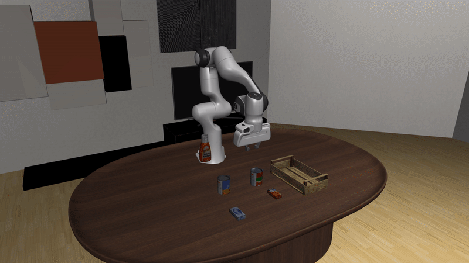

# LIBERO post-training

Raise a frozen robot policy's success rate on a LIBERO tabletop task by steering it with reinforcement learning, leaving the policy's weights untouched.
The full step-by-step guide is [docs/pages/workflows/libero.md](../../docs/pages/workflows/libero.md).

**Status:** exploratory (one pi0 task measured under the evaluation protocol; see Results)



A successful episode of the LIBERO-90 task "pick up the cream cheese and put it in the tray" (`LIVING_ROOM_SCENE3`) in real time, from the frozen pi0 policy without steering.

## Overview

The workflow steers the flow-matching noise of a frozen vision-language-action policy on one LIBERO task (MuJoCo, a Franka Panda arm, four ten-task suites plus LIBERO-90).
The frozen policy is GR00T N1.7 (`nvidia/GR00T-N1.7-LIBERO`), pi0 (through openpi, as in the DSRL paper) or DreamZero.
A small agent trained with SAC (`dsrl_sac`) or PPO (`dsrl_ppo`) chooses the noise sample the policy decodes into actions.
The output is a steering-actor checkpoint and success rates, compared with the frozen policy's rate under the same evaluator.
The same launcher also fine-tunes GR00T N1.7 or pi0 itself offline from demonstrations (`ALGO=sft` or `ALGO=iql`, untested).

## Requirements

| | |
|---|---|
| Hardware | Linux x86_64 with one NVIDIA GPU with 48 GB of memory (driver for CUDA 12.8 or newer, with EGL); installation and the setup checks before the pre-flight evaluation need no GPU |
| Software | this repository (`uv sync`), plus a separate Python 3.11 environment with LIBERO and the stack of the policy you steer, at the commits in `externals.lock.yaml` |
| Checkpoints | GR00T: one suite folder of `nvidia/GR00T-N1.7-LIBERO` (about 7 GB); pi0: `pi0_libero`, fetched on first use; DreamZero: `RLinf/RLinf-DreamZero-WAN2.2-5B-LIBERO-SFT-Step26000`; steering needs no dataset, `ALGO=sft|iql` a LeRobot one |
| Access | a Hugging Face account that has accepted the gated `nvidia/Cosmos-Reason2-2B` (GR00T N1.7's backbone); Weights & Biases is optional (`WANDB_API_KEY`) |

Install LIBERO and the policy stack as in the [guide](../../docs/pages/workflows/libero.md#install-libero), then, in every shell, from the repository root:

```bash
export LIBERO_ROOT=$HOME/LIBERO LIBERO_VENV=$HOME/libero-venv
source "$LIBERO_VENV/bin/activate"
export LIBERO_CONFIG_PATH=$LIBERO_VENV/libero_config MUJOCO_GL=egl
export GR00T_CKPT=<the libero_10 folder of nvidia/GR00T-N1.7-LIBERO>
```

## Quickstart

From the repository root:

```bash
uv run bash example_workflows/libero_posttraining/smoke.sh       # no GPU, no LIBERO; ends with `smoke check passed`

# GR00T N1.7 steered with DSRL on one LIBERO-10 task: 100,000 steps, a 50-episode evaluation every 5,000
POSTTRAIN_BASE_CKPT=$GR00T_CKPT GPU=0 \
  bash example_workflows/libero_posttraining/scripts/train.sh KITCHEN_SCENE8_put_both_moka_pots_on_the_stove

# The frozen policy on every task of the suite, 20 episodes per task
CUDA_VISIBLE_DEVICES=0 python example_workflows/libero_posttraining/scripts/eval.py \
    --checkpoint "$GR00T_CKPT" --suite libero_10 --episodes 20 --output-dir logs/libero_eval
```

Training writes checkpoints and `checkpoints/evaluation_summary.json` under `~/isaac_rl_outputs/<run name>_<timestamp>/` and logs each evaluation as `[EVAL] Success Rate: <percent>`.
`eval.py` writes `logs/libero_eval/results.jsonl` and `results.md`.
`BASE_MODEL=pi0|dreamzero_local` and `ALGO=rfs|sac_edit|dsrl_ppo|sft|iql` in front of `train.sh` select another policy or algorithm (`sft` and `iql` also need `POSTTRAIN_DATASET_DIR`).
The guide gives each recipe and the launcher variables.

## Results

<!-- results:start -->
| Task | Method | Base | Peak | Final | Note |
|---|---|---|---|---|---|
| cream cheese into tray | DSRL | 29.0% n=100 | 44.0% n=50 | 44.0% n=50 |  |
| cream cheese into tray | RFS | 29.0% n=100 | 82.0% n=50 | 14.0% n=50 |  |
| both moka pots on stove | DSRL-PPO | 71.9% n=64 | 81.2% n=64 | 79.7% n=64 | LIBERO-10 task 8 under the frozen GR00T N1.7 policy, `runtime=rlinf`, one seed, 20 iterations; peak re-scored from iteration 15, final from iteration 20, on the same 64 seeded episodes; 2026-09-12 |

Success rates; n is the episode count. Evaluator: LIBERO-90 `put the cream cheese box in the tray` under the frozen pi0 policy, MuJoCo, stochastic steering actor, success when the task's success condition fires within the episode step cap. The frozen policy is scored in the same session as the runs. Peak is the best evaluation of a run and final is its last; each row is one training run. Measured 2026-09-21, except where a row names its own.
<!-- results:end -->

The DSRL and RFS rows steer the frozen pi0 on the LIBERO-90 cream-cheese task of the guide's pi0 command.
Each row is one training run, so a reproduction can differ by more than the sampling noise of a 50-episode evaluation.
Other measurements (GR00T N1.7 on LIBERO-10, the pi0 training curve in `results/dsrl_pi0_libero90_task57.png`, DreamZero) are in `simulators/libero/README.md`.
To add a row, score the retained steering checkpoint and the frozen policy under the same evaluator on 100 or more episodes each, add it to `results/results.json`, and regenerate the table with `uv run python -m example_workflows._common.results_table example_workflows/libero_posttraining/results/results.json --write example_workflows/libero_posttraining/README.md`.

## Method

The frozen policy decodes an action chunk from a noise sample by flow matching, and the steering actor chooses that sample.
For GR00T N1.7 the sample is 7 values per flow step over a 40-step window (`dsrl.noise_dim=7`, `training.chunk_size=40`), bounded to [-1, 1], and 8 of the 16 decoded actions execute per decision.
For pi0 one 32-dim sample is broadcast across its 50-step chunk and 20 actions execute; for DreamZero one 32-dim sample is tiled across its 16-step chunk and all 16 execute.
`dsrl_sac` uses the DSRL paper's SAC hyperparameters (`isaac_rl_posttraining/configs/algorithm/dsrl_sac.yaml`) with a critic on frozen DINOv2 features.
`dsrl_ppo` trains the same actor with PPO (`docs/ppo.md`); `sft` and `iql` train the policy's own action head (`docs/sft.md`, `docs/iql.md`).
LIBERO steps in-process (`simulators/libero/env.py`).
The GR00T recipe's reward is 0 on success and -1 on failure or at the 720-step cap; the pi0 and DreamZero recipes use -1 per step.
Training evaluates the stochastic steering policy every 5,000 steps on 50 episodes with separately seeded workers.
`eval.py` walks the benchmark's fixed initial states in order, so repeated runs start from the same states without setting seeds.

## Files

| Path | Purpose |
|---|---|
| `smoke.sh` | the setup check CI runs: launcher dry runs (each ending in the library's), the Python recipe's dry run, the golden-config check, the results table |
| `scripts/train.sh` | trains on one LIBERO task with the policy `BASE_MODEL` selects and the algorithm `ALGO` selects; its header lists every knob |
| `scripts/train_ppo.sh` | the same launcher with `ALGO=dsrl_ppo` |
| `scripts/eval.py` | native GR00T evaluation of a suite (the frozen policy alone), with a per-task report |
| `run.py` | the GR00T steering recipe of `train.sh` from Python (`launch(DSRL(...), ...)`) |
| `results/results.json` | every reported number with its provenance |
| `results/dsrl_pi0_libero90_task57.png` | training curve of the pi0 reproduction (not a result) |
| `externals.lock.yaml` | the external repositories: LIBERO, Isaac-GR00T, dsrl_openpi, dreamzero |
| `tests/` | launcher dry runs, the resolved config of every recipe against `tests/golden_config.json`, the evaluation script's pure parts, the results table |
