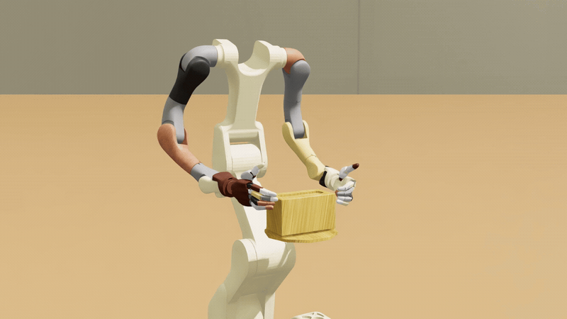
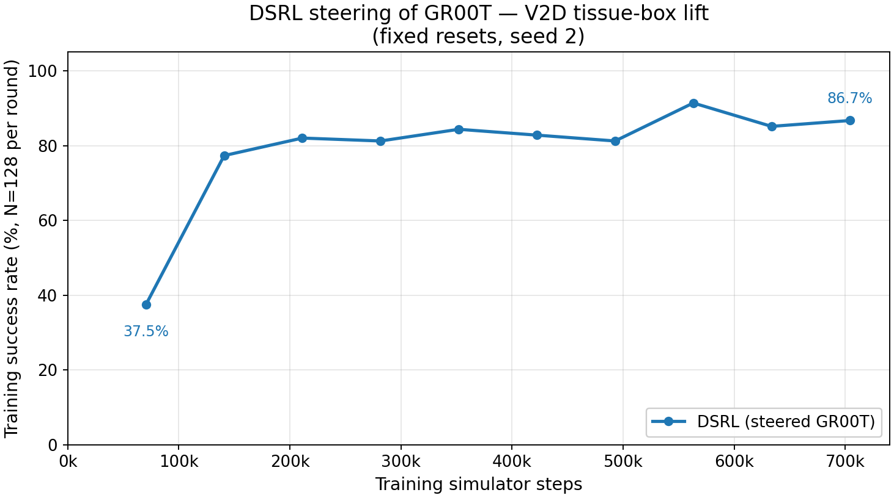

# Video-to-Data (V2D) tissue-box RL post-training

Train a Vega/Sharpa robot to lift and hold a tissue box in [Video-to-Data (V2D)](https://github.com/nvidia-isaac/video_to_data) using reinforcement learning and a pretrained GR00T policy.
The full guide, including running without Docker, from Python and evaluating checkpoints, is [docs/pages/workflows/v2d_box_lift.md](../../docs/pages/workflows/v2d_box_lift.md).

**Status:** exploratory. Automated CPU checks pass; a hardware benchmark for this release has not been published.

**Note:** this workflow has not been fully tested. It has only been run with an NVIDIA 580-series driver (580.95.05); the Video-to-Data image runs Isaac Sim 5.1, which does not support newer drivers such as the 595 series.



A successful episode in real time, from the frozen Video-to-Data tissue-box GR00T policy without steering.

## Overview

DSRL learns to steer the actions of a frozen GR00T policy on Video-to-Data v0.4.0's tissue-box task, scored with Video-to-Data's standard success criteria.
With evaluation enabled, the frozen policy and the steering policy are compared on the same cases.

## Requirements

| | |
|---|---|
| Hardware | an NVIDIA RTX-class GPU with at least 48 GB of memory, such as an L40S or RTX PRO 6000 Blackwell |
| OS and driver | Ubuntu 24.04 LTS on x86-64 with an NVIDIA 580-series driver; the Video-to-Data image runs Isaac Sim 5.1, which does not support newer drivers such as the 595 series |
| Software | Docker with Buildx, the NVIDIA Container Toolkit, and Git; the image includes Video-to-Data, Isaac Sim / Isaac Lab and GR00T |
| Repository | a `git clone` of this repository; the image build reads the checkout's commit |
| Model access | a Hugging Face read token for the [tissue-box checkpoint](https://huggingface.co/nvidia/video-to-data-GR00T-N1.7-finetuned-tissue-box-lift) and `nvidia/Cosmos-Reason2-2B`; step 4 of the [guide](../../docs/pages/workflows/v2d_box_lift.md#installation-and-training-with-docker) gets access and checks the token |

`nvidia-smi` should report a 580-series driver, and `docker run --rm --gpus all ubuntu nvidia-smi` should print your GPU table before you start.

## Quickstart

From the repository root (`git clone https://github.com/nvidia-isaac/isaac-rlpt.git && cd isaac-rlpt`):

```bash
read -rsp 'Hugging Face token: ' HF_TOKEN && export HF_TOKEN && echo
bash example_workflows/v2d_box_lift_posttraining/scripts/docker_train.sh \
  --gpus 0 \
  --output-dir "$HOME/data_drive/v2d-posttraining/runs/run-001" \
  -- --training-steps 2000 --override logging.wandb_offline=true
```

The first launch builds the image and downloads the checkpoint.
Checkpoints land in `run/run_outputs/` under the output directory; use a fresh output directory for every run.
To evaluate during training, use `--gpus 0,1,2` and add `--evaluation-mode enabled --eval-num-episodes 10` after `--`.
The CPU check, `uv run bash example_workflows/v2d_box_lift_posttraining/smoke.sh`, needs `uv sync` and no GPU.

## Results

<!-- results:start -->
No validated evaluation results have been published yet.
<!-- results:end -->



*An example training curve.*
*It shows training progress, not an independent evaluation.*

## Method

1. **Rollout.** GR00T predicts 58 joint positions in chunks of 16 (the J0_N16 configuration), and four execute before the next prediction.
   Each episode lasts 550 steps, with the box placed within ±1 cm in X/Y ([task configuration](configs/tasks/tissue_box_lift_hold_xy_1cm_550_fixed.json)).
2. **Scoring.** Success, worth reward 1, is Video-to-Data's rule: lift at least 10 cm, hold at least 5 cm up for 20 consecutive samples, and end no more than 1 cm below the start.
3. **Optimization.** DSRL trains a small steering policy while GR00T's weights stay fixed; learning begins after one episode of data per environment.

See [DSRL](../../docs/pages/algorithms/dsrl.md) for the algorithm and [the evaluation protocol](../_common/EVALUATION.md) for reporting.

## Files

| Path | Purpose |
|---|---|
| `scripts/docker_train.sh`, `scripts/docker_build.sh` | build and run the Docker workflow |
| `scripts/train.sh`, `scripts/eval.sh` | train and evaluate with an existing simulator installation |
| `launch.py` | the launcher behind both scripts; also gives the learner as a Python run handle |
| `configs/` | the default task configuration and training settings (`configs/recipe.yaml`) |
| `externals.lock.yaml` | exact simulator and model revisions |
| `compare_native.py` | compare frozen and steered policies on the same evaluation cases |
| `results/results.json` | published evaluation results and their provenance |
| `smoke.sh`, `tests/` | checks that run without a GPU, including the resolved config of every launch against `tests/golden_config.json` |
