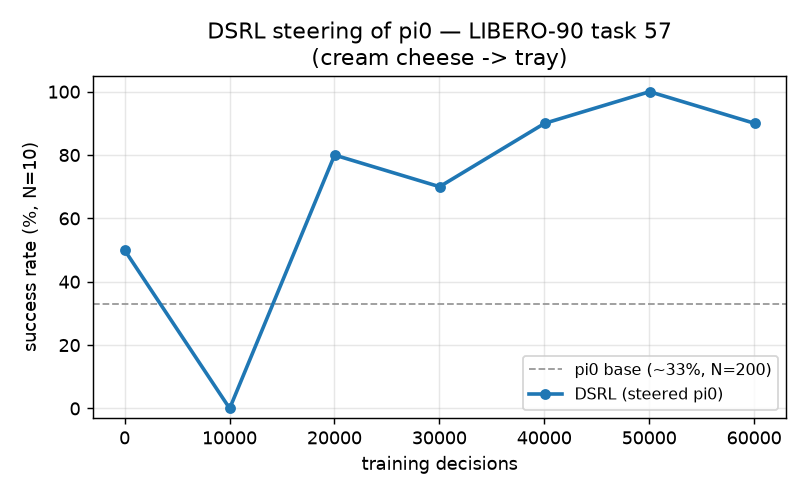

# LIBERO

[LIBERO](https://github.com/Lifelong-Robot-Learning/LIBERO) tabletop manipulation (MuJoCo/robosuite, a Franka Panda, four ten-task suites) stepped in-process: provider `libero` (`simulators/libero/env.py`), entries `Libero`, `LiberoPi0` and `LiberoDreamZero` (`simulators/libero/runtime.py`), config groups `simulator/libero_{spatial,object,goal,10}.yaml`.
The user guide, with the policy stacks (Isaac-GR00T, `dsrl_openpi`, `dreamzero`), is `docs/pages/workflows/libero.md`; this page is the integration reference.

## Setup

LIBERO is not on PyPI and pins `numpy<2` and the legacy `gym`, so it runs in a separate Python 3.11 environment.
Run every command from the repository root, `isaac-rlpt/`; the paths under `$HOME` are defaults.

1. Clone LIBERO and apply its packaging fix (without the file an editable install succeeds but `import libero` fails):

   ```bash
   export LIBERO_ROOT=$HOME/LIBERO
   git clone https://github.com/Lifelong-Robot-Learning/LIBERO "$LIBERO_ROOT"
   git -C "$LIBERO_ROOT" checkout 8f1084e3132a39270c3a13ebe37270a43ece2a01    # the revision in example_workflows/libero_posttraining/externals.lock.yaml
   touch "$LIBERO_ROOT/libero/__init__.py"
   ```

2. Create the environment with the simulator pins (the same set is this repository's `libero` extra):

   ```bash
   export LIBERO_VENV=$HOME/libero-venv
   sudo apt install -y build-essential      # robosuite's evdev dependency compiles from source
   uv venv --python 3.11 "$LIBERO_VENV"
   source "$LIBERO_VENV/bin/activate"
   uv pip install --no-config \
       "numpy==1.26.4" "robosuite==1.4.1" "bddl==1.0.1" "mujoco==2.3.7" \
       "gym==0.25.2" "pyarrow<26" gymnasium pyyaml matplotlib easydict opencv-python-headless future
   ```

3. Install LIBERO and this repository into the environment, then the policy stack as in the user guide:

   ```bash
   uv pip install --no-config -e "$LIBERO_ROOT"
   uv pip install --no-config -e .
   ```

4. Give this checkout its own LIBERO config; LIBERO's first import otherwise blocks on an interactive prompt, and its default config is global per user:

   ```bash
   export LIBERO_CONFIG_PATH=$LIBERO_VENV/libero_config
   mkdir -p "$LIBERO_CONFIG_PATH"
   cat > "$LIBERO_CONFIG_PATH/config.yaml" <<EOF
   benchmark_root: $LIBERO_ROOT/libero/libero
   bddl_files: $LIBERO_ROOT/libero/libero/bddl_files
   init_states: $LIBERO_ROOT/libero/libero/init_files
   assets: $LIBERO_ROOT/libero/libero/assets
   datasets: $LIBERO_ROOT/datasets
   EOF
   ```

5. Set up headless rendering (check with `ldconfig -p | grep libEGL_nvidia`; `sudo apt install libosmesa6` and `MUJOCO_GL=osmesa` is the software fallback):

   ```bash
   sudo apt install -y libegl1 libgl1 libglib2.0-0
   export MUJOCO_GL=egl
   ```

In every shell that touches LIBERO, activate the environment and export `LIBERO_CONFIG_PATH` and `MUJOCO_GL`; the launcher runs whatever `python3` is on `PATH` (`LEARNER_PYTHON` overrides).
Every `uv pip install` into this environment needs `--no-config`; without it `uv` applies this repository's torch 2.9 pin.

Verify by resetting one task through the provider; the first boot takes about 30 s while robosuite compiles the scene:

```bash
python - <<'EOF'
from simulators.libero.env import LiberoEnv
env = LiberoEnv(suite="libero_spatial", task_id=0, image_size=256, seed=0)
obs, info = env.reset(seed=0)
print(obs["agentview_image"].shape, obs["state"].shape, obs["prompt"])
env.close()
EOF
```

It passes when it prints `(256, 256, 3) (9,) pick up the black bowl between the plate and the ramekin and place it on the plate`.

## Usage

In the LIBERO environment, from the repository root; `GR00T_CKPT` is the local `libero_10` folder of `nvidia/GR00T-N1.7-LIBERO`, and `GPU` and `CUDA_VISIBLE_DEVICES` take a CUDA device index.

```bash
CUDA_VISIBLE_DEVICES=0 \
  python example_workflows/libero_posttraining/scripts/eval.py --checkpoint "$GR00T_CKPT" --suite libero_10 --episodes 20
```

Native evaluation of the frozen GR00T N1.7 policy on every task of a suite, walking the benchmark's fixed initial states in order (2 to 5 minutes per task); `--tasks`, `--max-episode-steps` (720) and `--n-action-steps` (8) narrow or change the protocol, and `--output-dir` receives `results.jsonl` and `results.md`.

```bash
POSTTRAIN_BASE_CKPT=$GR00T_CKPT GPU=0 \
  bash example_workflows/libero_posttraining/scripts/train.sh KITCHEN_SCENE8_put_both_moka_pots_on_the_stove
```

DSRL on one LIBERO-10 task: 100,000 environment steps with a 50-episode evaluation every 5,000.
The task is a name or its index in the suite, `SUITE` selects the suite (default `libero_10`), `BASE_MODEL=pi0` or `BASE_MODEL=dreamzero_local` selects another frozen policy with its own recipe, and any trailing `key=value` is a Hydra override.
`ISAAC_RL_POSTTRAINING_DRYRUN=1` in front prints the resolved plan and exits; `TRAIN_MAXSTEPS`, `NUM_ROLLOUTS`, `ALGO` (`dsrl_sac|rfs|sac_edit|dsrl_ppo|sft|iql`; `sft` and `iql` read `POSTTRAIN_DATASET_DIR`), `RUNTIME`, `NUM_ENVS`, `RECIPE` (`dino|pixel`, DreamZero only), `LOG_DIR` and `ISAAC_RL_POSTTRAINING_OUTPUT_DIR` are the other knobs, listed in the launcher header.

## Integration facts

- **Config group keys** (the same in the four suite files): `provider: libero`, `suite`, `max_episode_steps: 600` (LIBERO's own evaluation cap; episodes end only on success, so the cap ends failures as truncations), `image_size: 256`, `camera_name: agentview`, the ten `tasks` in the suite's canonical order, and a `gr00t_eval` block with the GR00T reference protocol (`max_episode_steps: 720`, `image_size: 256`, `action_horizon: 16`, `n_action_steps: 8`) that the launcher and `eval.py` read.
- **Environment names**: `env.env_name=<entry>/<suite>/<task>`, the task by name or index: `libero/libero_10/<task>` (GR00T conventions), `libero_pi0/libero_90/<task>`, `libero_dreamzero/libero_spatial/<task>`.
  `libero_90` is accepted by `LiberoEnv` but has no config entry.
- **`LiberoEnv` contract**: `agentview_image` (`uint8 [image_size, image_size, 3]`, upright; the raw MuJoCo buffer is upside down), `state` (`float32 [9]`: `robot0_joint_pos` plus `robot0_gripper_qpos`) and `prompt` (the language instruction); actions are `float32 [7]` end-effector deltas, a `[chunk, 7]` action executes row by row, and `info["success"]` and `info["is_success"]` carry the BDDL goal (`LIBERO_KEY_MAPPING`).
- **GR00T N1.7 conventions** (`simulators/libero/policies/gr00t.py`, matching the reference evaluation in Isaac-GR00T): the `agentview` and `robot0_eye_in_hand` cameras as `video.image` and `video.wrist_image` at 256x256, frames upright plus a horizontal flip, an 8-dim state (end-effector position, axis-angle orientation, two gripper joints), 7-dim actions with the gripper decoded in [0, 1] and sent as +-1, a 720-step cap, and 8 of the 16 decoded actions executed per inference (`dsrl.noise_dim=7`, `training.chunk_size=40`, `dsrl.action_exec_len=8`).
  The checkpoint is self-describing (`libero_sim` embodiment and statistics baked in); point `POSTTRAIN_BASE_CKPT` at the suite subfolder.
- **pi0** (`simulators/libero/policies/pi0.py`, `BASE_MODEL=pi0`): a 50-step flow chunk of 32-dim latents decoding 7-dim actions, 20 executed per decision; `training.chunk_size=50` steers a per-step latent and `training.chunk_size=null` broadcasts one latent across the chunk.
  pi0 needs `mujoco==3.3.1` (under 2.3.7 its base success rate on the reference task is 2 to 4 percent instead of about 33); the `pi0_libero` checkpoint downloads on first use from `gs://openpi-assets/checkpoints/pi0_libero/`.
- **DreamZero** (`simulators/libero/policies/dreamzero.py`, `BASE_MODEL=dreamzero_local`): one 32-dim latent per decision (`dsrl.noise_dim=32`, `training.chunk_size=null`) tiled across the checkpoint's 16-step chunk, all 16 actions executed (`dsrl.action_exec_len=16`), 240-step episodes.
  `SUITE` must be the checkpoint's own fine-tuning suite (`libero_spatial` for the reference 5B checkpoint; other suites score near zero), `RECIPE=pixel` selects the reference-validated pixel recipe, and `base_model.num_dit_steps` and `base_model.text_encoder_cpu_offload=true` trade fidelity for speed and memory.
- **Entries**: evaluation uses `fresh_workers` (rebuilt, independently seeded simulators; evaluation seeds are offset by 1000 from training seeds), one environment per worker, `base_models` pinned per entry (`gr00t`, `gr00t_n15` and `gr00t_n17`; `pi0`; `dreamzero_local` and `dreamzero_server`); `NUM_ENVS=8 RUNTIME=rlinf` runs eight simulators as parallel rollout workers (`docs/runtimes.md`).
- **Demonstrations** (offline data, BC baselines): the official 128x128 HDF5 via LIBERO's `benchmark_scripts/download_libero_datasets.py`, or the 256x256 LeRobot conversion (`physical-intelligence/libero` on Hugging Face); check the frame orientation before mixing datasets.
- **Tests**: `uv run pytest simulators/libero/tests -q`; every test carries the `libero` marker and skips without the LIBERO stack, `simulators/libero/tests/test_libero_loading.py` boots one real task on the CPU (`MUJOCO_GL=egl`), and `simulators/libero/tests/test_libero_gr00t_native.py` needs a GPU.

Failures and fixes are in `docs/pages/troubleshooting.md` (LIBERO section).
`mj_fullM(): incompatible function arguments` comes from MuJoCo 3.x with robosuite 1.4.x on a utility path; rollouts themselves run on `mujoco==3.3.1` (pi0), and `mujoco==2.3.7` is for the GR00T stack whose reference numbers were measured there.

## Reference results

These numbers sit outside the evaluation protocol of `example_workflows/_common/EVALUATION.md`, each for the reason stated; the maintained table is in the workflow README.

### GR00T N1.7 on LIBERO-10

Frozen policy, 20 episodes per task (below the protocol's 50; per-task numbers carry ±0.15 of binomial noise):

| Task | SR |
|---|:---:|
| put both the alphabet soup and the tomato sauce in the basket | 0.75 |
| put both the cream cheese box and the butter in the basket | 1.00 |
| turn on the stove and put the moka pot on it | 0.95 |
| put the black bowl in the bottom drawer of the cabinet and close it | 1.00 |
| put the white mug on the left plate and the yellow/white mug on the right plate | 0.85 |
| pick up the book and place it in the back compartment of the caddy | 0.85 |
| put the white mug on the plate and the pudding to the right of the plate | 0.85 |
| put both the alphabet soup and the cream cheese box in the basket | 1.00 |
| put both moka pots on the stove | 0.65 |
| put the yellow and white mug in the microwave and close it | 0.80 |

Suite mean 87.0% (upstream reports 94.35% under its own harness).

DSRL on the hardest LIBERO-10 task, both measured at N≥300 with no exact episode count:

| Task | base | DSRL |
|---|:---:|:---:|
| put both moka pots on the stove | 0.72 | 0.72 |

DSRL does not change the base success rate on this task; single 50-episode evaluations scatter ±7 points around the base rate.

### pi0 on LIBERO-90

pi0's zero-shot base on the DSRL paper task (`LIVING_ROOM_SCENE3_pick_up_the_cream_cheese_and_put_it_in_the_tray`) is 0.33 (N=200, `mujoco==3.3.1`).
DSRL steers it to 1.00 on two seeds, which then hold in the 90–100 band, reproducing the paper; these are in-training evaluations at N=10 (stochastic) every 10k decisions, not a fresh evaluation of the retained checkpoint:



The critic's mean Q stays below the return ceiling (0) on runs that climb and hold, and diverges above it on runs that reach 100% only briefly.

### DreamZero on LIBERO-Spatial

The recipe ports RLinf's validated integration, whose reference (not measured with this repository) is 81.25% after supervised fine-tuning and 90.6% after DSRL with the 5B model.
